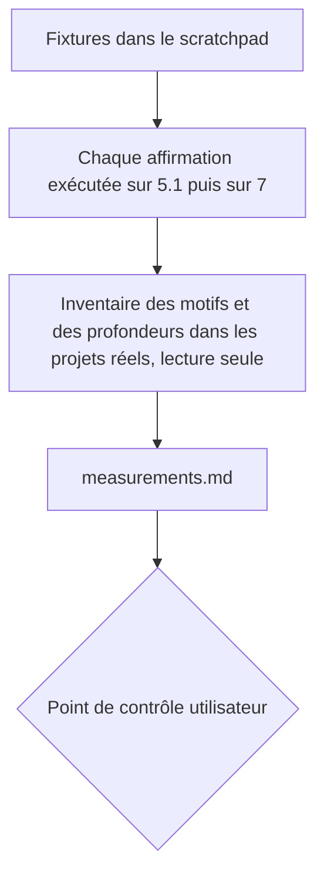
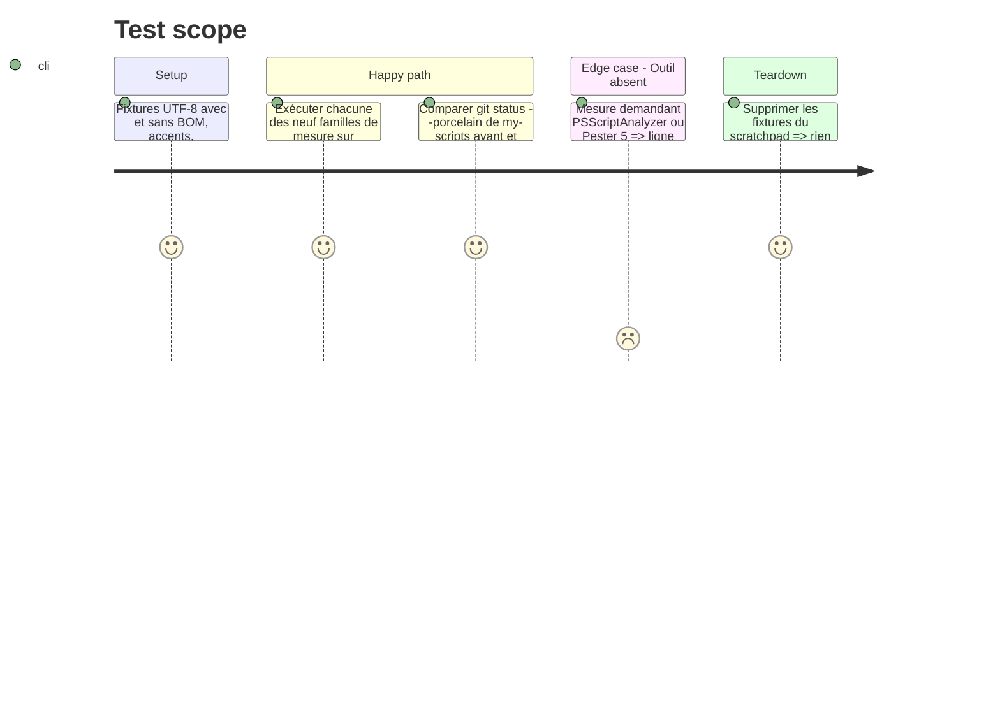

# Instruction: Mesures sur les deux hôtes

## Architecture projection

> Tree of the final files. ✅ create · ✏️ modify · ❌ delete

```txt
aidd_docs/tasks/2026_10/2026_10_28_sc-pwsh/
└── measurements.md        ✅ journal daté des mesures (appendice, jamais cité par un SKILL.md)
```

## User Journey



## Test Scope



## Tasks to do

### `1)` Préparer les fixtures

> Un terrain jetable, hors dépôt.

1. Créer dans le scratchpad de la session : un script avec BOM et un sans, tous deux avec des accents ; un script par construction 7-only ; une fonction avancée `SupportsShouldProcess`.
2. Relever `$PSVersionTable` des deux hôtes pour l'en-tête du journal.

### `2)` Mesurer chaque famille sur `powershell.exe` (5.1) puis `pwsh` (7)

> Une ligne de journal par affirmation : commande, hôte, version, sortie observée, verdict.

1. Encodage par défaut de `Set-Content`, `Out-File`, `>` ; lecture d'un script accentué sans BOM.
2. Disponibilité de `??`, `?.`, ternaire, `&&` / `||`, `ForEach-Object -Parallel`.
3. `try/catch` sur erreur non terminante, avec et sans `-ErrorAction Stop`.
4. `ShouldProcess`, `-WhatIf`, `-Confirm` : propagation dans les fonctions avancées.
5. `Set-StrictMode`, `$ErrorActionPreference`, `$PSNativeCommandUseErrorActionPreference`.
6. Arguments vers un exécutable natif : guillemets et échappement.
7. `[System.Management.Automation.Language.Parser]::ParseFile` : disponible sur les deux hôtes sans module, et ce qu'il détecte (erreurs de syntaxe, alias, `Invoke-Expression`) ; un fichier 7-only passé au parseur de 5.1 : erreur rendue, ou non.
8. Déclaration d'hôte, base de la détection de `sniff` : `#Requires -Version 7` et `-PSEdition Core` sur chaque hôte (rejet ou exécution), `PowerShellVersion` et `CompatiblePSEditions` d'un `.psd1` lus par `Test-ModuleManifest` et `Import-PowerShellDataFile`, shebang `#!/usr/bin/env pwsh` (ignoré ou non sous Windows).
9. Écarts de cmdlets et de défauts, base de `legacy` : disponibilité de `Get-WmiObject`, `Get-Content -Encoding Byte`, `Invoke-WebRequest` sans `-UseBasicParsing`, `ConvertTo-Json` (profondeur par défaut), `Out-File` / `Set-Content` sans `-Encoding` (déjà en 1 : renvoyer, ne pas refaire). Toute entrée de `powershell-versions.md` renvoie à une ligne de cette famille.

### `3)` Inventorier les projets réels, en lecture seule

> Dimensionner la borne de détection et séparer conventions de projet et savoir de stack.

1. Relever `git status --porcelain` de `my-scripts`.
2. Sans manifeste, la racine d'un projet PowerShell n'est pas lisible : `sniff` part du dossier courant de l'utilisateur. Lister la profondeur de chaque `.ps1` (87) par rapport à trois points de départ plausibles : la racine de `my-scripts`, chacun de ses sous-dossiers de premier niveau, chacun de ses sous-dossiers de second niveau. En déduire la borne de `sniff` (la plus petite qui voit tous les `.ps1` depuis le premier niveau) et la **simuler à la main** contre ces chemins, une ligne par point de départ.
3. Compter les motifs présents dans `my-scripts` : `#Requires`, `Set-StrictMode`, `SupportsShouldProcess`, dry-run par défaut. Ce sont des conventions de projet : elles restent dans sa mémoire, pas dans le pivot.
4. Relever de nouveau `git status --porcelain` et comparer.

### `4)` Écrire `measurements.md`

> Un journal daté, hors des fichiers d'instruction.

1. Un tableau par famille ; une section « Non mesurable sur ce poste » (PSScriptAnalyzer absent, Pester 5 absent, hôtes non Windows, effet du shebang hors Windows).
2. Terminer par la borne de profondeur retenue et la preuve de sa simulation.

## Test acceptance criteria

| Task | Acceptance criteria                                                                                                  |
| ---- | -------------------------------------------------------------------------------------------------------------------- |
| 1    | Les fixtures existent dans le scratchpad et les deux versions d'hôte sont notées.                                    |
| 2    | Chacune des neuf familles a une ligne par hôte avec sortie observée ; aucune ligne n'est une déduction.             |
| 3    | `git status --porcelain` de `my-scripts` est identique avant et après ; la borne de profondeur est justifiée par les 87 chemins. |
| 4    | `measurements.md` existe, distingue mesuré et non mesurable, et aucun fichier hors du scratchpad et du dossier de tâche n'a changé. |
