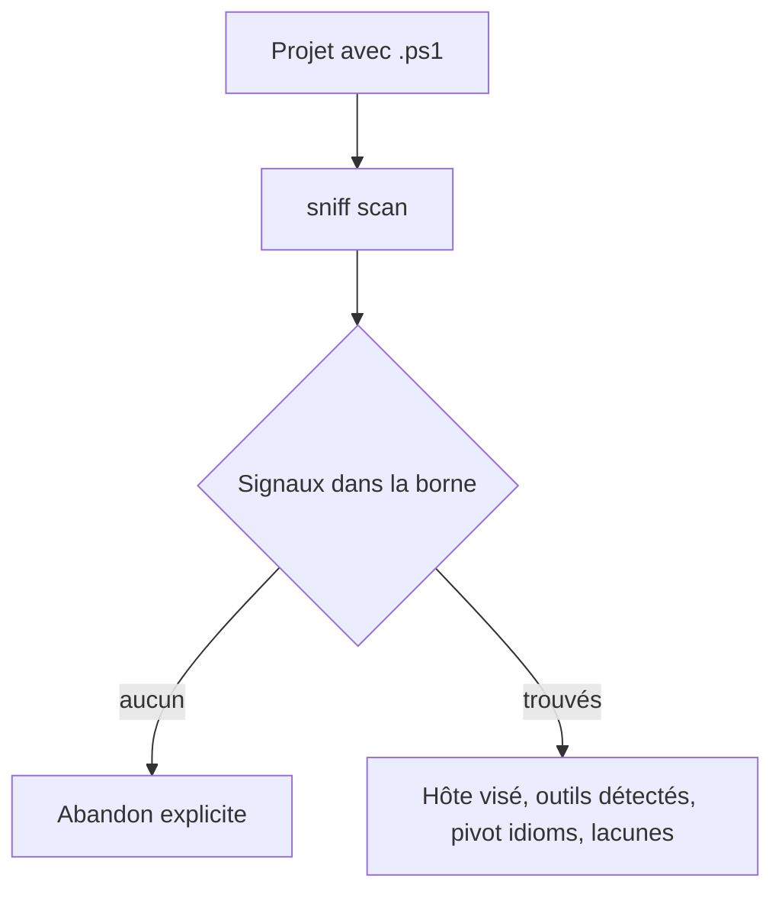
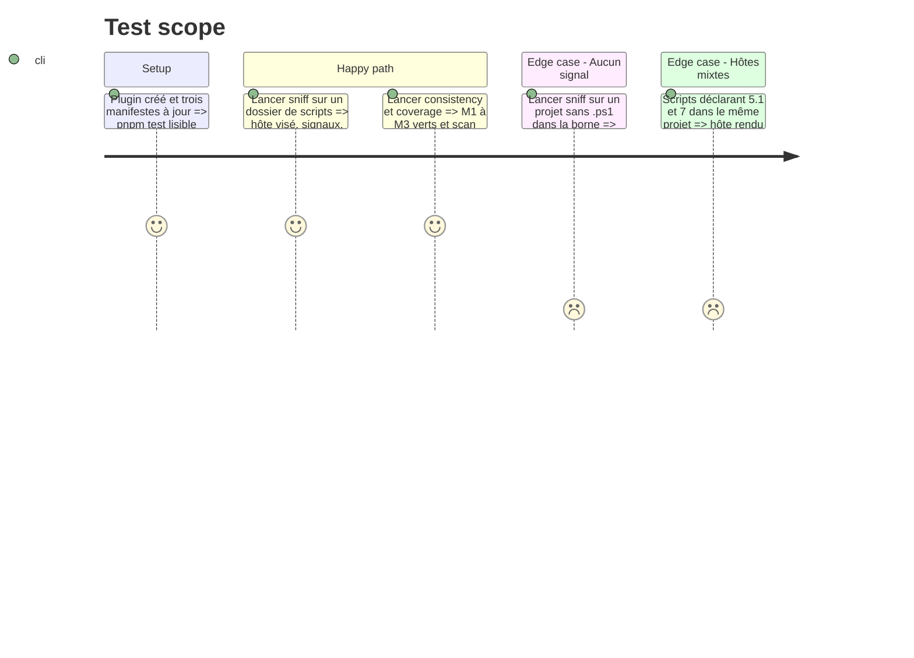

# Instruction: Coquille, enregistrement et sniff

## Architecture projection

> Tree of the final files. ✅ create · ✏️ modify · ❌ delete

```txt
.
├── .claude-plugin/marketplace.json                         ✏️ entrée sc-pwsh (version, description identiques au plugin)
├── .agents/plugins/marketplace.json                        ✏️ entrée locale, politique, catégorie
├── index.json                                              ✏️ id + name uniquement (M3 interdit tout autre champ)
└── plugins/sc-pwsh/
    ├── .claude-plugin/plugin.json                          ✅ 0.1.0
    ├── .codex-plugin/plugin.json                           ✅ même name/description, version 0.1.0, skills, interface
    ├── references/host-portability.md                      ✅ copie de sc-rust, SC_PWSH_PLUGIN_ROOT
    └── skills/sniff/
        ├── SKILL.md                                        ✅
        ├── actions/01-scan.md                              ✅ pas d'action install-pivots
        ├── references/capabilities/powershell/idioms.md    ✅ issu de measurements.md
        └── evals/scenarios.json                            ✅
```

## User Journey



## Test Scope



## Tasks to do

### `1)` Coquille du plugin

> Un plugin que M1 à M3 acceptent.

1. Écrire `plugin.json` Claude (0.1.0, auteur, `description` anglaise courte) et `plugin.json` Codex : mêmes `name` et `description`, version identique, `skills: ./skills/`, bloc `interface` (nom d'affichage, prompts par défaut).
2. Copier `host-portability.md` depuis `sc-rust`, en remplaçant le nom du plugin et la variable de racine.

### `2)` Enregistrement

> Trois manifestes, un seul jeu de valeurs.

1. Ajouter l'entrée dans `.claude-plugin/marketplace.json` (`recommended: false`), `.agents/plugins/marketplace.json` (source locale, `AVAILABLE`, `ON_INSTALL`, `Developer Tools`) et `index.json` (`id`, `name`).

### `3)` `sniff` : scan

> Détecter sans manifeste, avec une borne écrite.

1. `SKILL.md` : même gabarit que `sc-rust` (frontmatter, table d'actions à une seule ligne `scan`, règles transversales) ; abandon explicite si aucun signal.
2. `actions/01-scan.md` : signaux `*.ps1`, `*.psm1`, `*.psd1`, `#Requires -Version`, `PSScriptAnalyzerSettings.psd1`, `*.Tests.ps1` ; la borne de profondeur issue de `measurements.md`, écrite dans l'instruction.
3. Rendre l'hôte visé par fichier, lu dans `#Requires`, `PowerShellVersion` / `CompatiblePSEditions` du `.psd1`, shebang, selon ce que la famille 8 de `measurements.md` a établi (un signal sans effet mesuré n'est pas lu) ; sans indication, le déclarer indéterminé. Un `.psd1` s'applique aux scripts de son dossier seulement s'ils l'importent : sinon l'hôte du script reste indéterminé.
4. Rendre les outils détectés (Pester, PSScriptAnalyzer) comme faits, pas comme pivots ; rapporter les lacunes.
5. Sortie en manifeste : capability pivot `powershell/idioms.md` chargé par `audit`, jamais installé sur disque.

### `4)` Pivot `idioms.md`

> Uniquement ce que `measurements.md` a établi.

1. Rédiger le pivot en anglais, agnostique du projet : encodage, erreurs non terminantes, `ShouldProcess`, mode strict, appels natifs, avec l'hôte concerné pour chaque règle.
2. Ne reprendre aucune convention propre à un projet.

### `5)` Scénarios

> Le scan est la seule action routable.

1. `evals/scenarios.json` : prompts bilingues routant vers `scan`, plus des négatifs (`expect_action: null`) pour audit, legacy et teach.

## Test acceptance criteria

| Task | Acceptance criteria                                                                                                      |
| ---- | ------------------------------------------------------------------------------------------------------------------------ |
| 1    | `plugin.json` Claude et Codex partagent `name`, `description` et version (au plus un cachebuster `+codex.*`).            |
| 2    | `consistency.mjs` ne rend aucune violation M1, M2 ni M3 pour `sc-pwsh`.                                                  |
| 3    | Sur un dossier de `.ps1` épars, `sniff` rend l'hôte par fichier et la liste des signaux ; sur un dossier vide, il abandonne avec un message explicite. |
| 4    | Chaque règle de `idioms.md` renvoie à une ligne de `measurements.md` ; aucune ne cite un projet ni un chemin du poste.   |
| 5    | `coverage.mjs` reste vert avec `scan` couvert.                                                                           |
