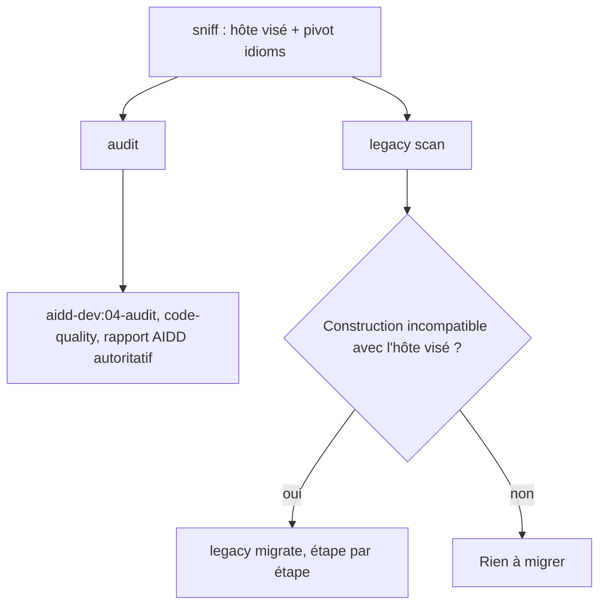
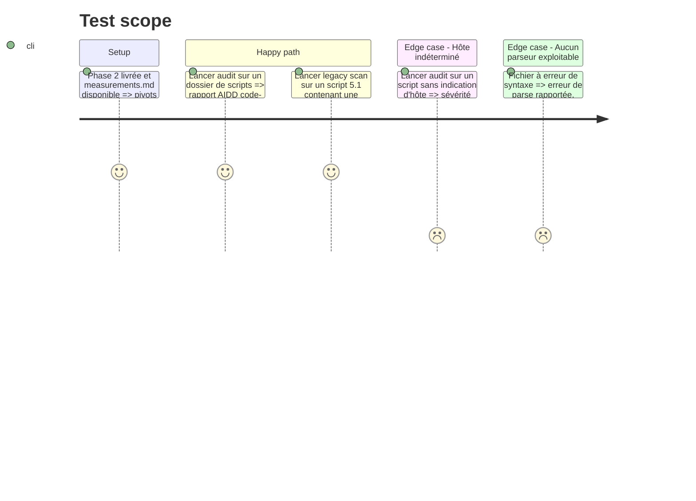

# Instruction: audit et legacy

## Architecture projection

> Tree of the final files. ✅ create · ✏️ modify · ❌ delete

```txt
plugins/sc-pwsh/skills/
├── audit/
│   ├── SKILL.md                                  ✅
│   ├── actions/01-audit.md                       ✅ délègue à aidd-dev:04-audit, pilier code-quality
│   └── evals/scenarios.json                      ✅
└── legacy/
    ├── SKILL.md                                  ✅
    ├── actions/01-scan.md                        ✅
    ├── actions/02-migrate.md                     ✅
    ├── references/powershell-versions.md         ✅ issu de measurements.md
    └── evals/scenarios.json                      ✅
```

## User Journey



## Test Scope



## Tasks to do

### `1)` `audit`

> Même contrat que les autres `sc-*:audit`.

1. `SKILL.md` : gabarit `sc-rust:audit` ; une seule action, déléguée à `aidd-dev:04-audit` avec le pilier `code-quality` et les pivots applicables ; le rapport AIDD reste autoritatif. L'action invoque `sniff` `scan` seulement, ne rien installer sur le disque du projet, lire les pivots sous `${SC_PWSH_PLUGIN_ROOT}/skills/sniff/references/capabilities/` ; abandon explicite si `scan` n'a trouvé aucun signal.
2. `actions/01-audit.md` : dimensions fondées sur le pivot et sur l'arbre syntaxique du parseur natif (mesuré en phase 1) : `Invoke-Expression`, secrets en clair, `-ErrorAction SilentlyContinue` généralisé, fonction destructive sans `SupportsShouldProcess`, absence de mode strict, alias dans un script.
3. Discipline de sévérité : conditionner chaque verdict à une propriété **mesurée** (hôte visé), jamais à la plateforme supposée ; toute indécidabilité en `info` ; « code mort » jamais affirmé au scan statique.

### `2)` `legacy`

> Scanner puis migrer, jamais l'inverse.

1. `SKILL.md` : chaîne séquentielle `scan` → `migrate`, comme `sc-rust:legacy`.
2. `actions/01-scan.md` : constructions incompatibles avec l'hôte déclaré (7-only dans un script 5.1, cmdlets retirées ou remplacées, comportements d'encodage divergents), limitées à celles de `powershell-versions.md` ; chaque entrée cite l'hôte qui la rejette. La détection de syntaxe passe par le parseur de l'hôte déclaré (`powershell.exe` pour 5.1, `pwsh` pour 7) ; si ce binaire est absent, l'entrée est rendue « non vérifiée », jamais déduite.
3. `actions/02-migrate.md` : migration par lots confirmés, un fichier à la fois, vérification de parse après chaque modification.
4. `references/powershell-versions.md` : uniquement les écarts présents dans `measurements.md`.

### `3)` Scénarios

> Un scénario par action routable.

1. `audit/evals/scenarios.json` et `legacy/evals/scenarios.json` : prompts bilingues, négatifs pour `sniff` et `teach`.

## Test acceptance criteria

| Task | Acceptance criteria                                                                                                          |
| ---- | ---------------------------------------------------------------------------------------------------------------------------- |
| 1    | `audit` délègue à `aidd-dev:04-audit` avec `code-quality` ; aucune dimension n'affirme une sévérité sans hôte mesuré.        |
| 2    | `legacy scan` rend, pour chaque entrée, la construction, le fichier et l'hôte qui la rejette ; `migrate` ne modifie rien sans confirmation. |
| 3    | `coverage.mjs` et `pnpm test` verts ; aucune référence ne contient un nom de projet ni un chemin du poste.                   |
