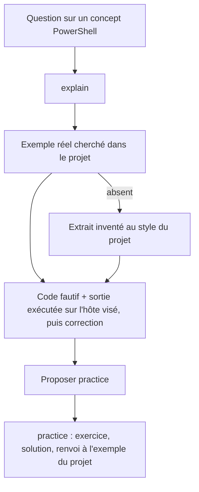
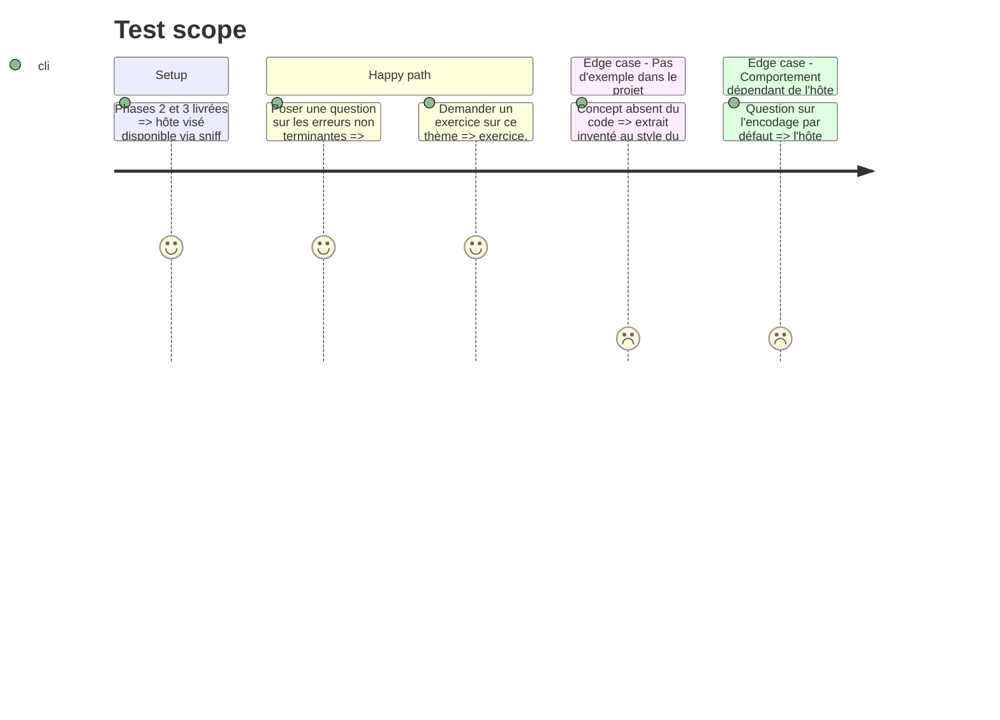

# Instruction: teach

## Architecture projection

> Tree of the final files. ✅ create · ✏️ modify · ❌ delete

```txt
plugins/sc-pwsh/skills/teach/
├── SKILL.md                      ✅
├── actions/01-explain.md         ✅
├── actions/02-practice.md        ✅
└── evals/scenarios.json          ✅
```

## User Journey



## Test Scope



## Tasks to do

### `1)` `SKILL.md`

> Même forme que `sc-rust:teach`.

1. Frontmatter et table d'actions (`explain`, `practice`) ; dispatch non séquentiel : « explain / how does / what is / difference between / show me / why does » → `explain` ; « practice / exercise / quiz / test me / challenge me » → `practice` ; ambigu → `explain` puis proposer `practice`.
2. Règles transversales : chercher d'abord un exemple réel du projet ; sinon un extrait inventé au style du projet ; théorie brève ; proposer `practice` après `explain`, la solution et le renvoi à l'exemple après `practice`.
3. Règle propre à PowerShell : pour tout comportement du langage (erreurs terminantes ou non, encodage par défaut, pipeline d'objets, portée, `$LASTEXITCODE` des natifs), montrer le code fautif **avec sa sortie exécutée dans le scratchpad sur l'hôte visé**, puis le code corrigé ; ne jamais citer une sortie de mémoire ; nommer l'hôte (5.1 ou 7) concerné.
4. Périmètre : langage et outillage ; hors administration Windows (cmdlets de gestion système).

### `2)` Actions

> Détaillées, concises, sans nom de projet.

1. `01-explain.md` : entrée sujet ou extrait ; recherche d'un exemple, explication ancrée sur lui, exécution avant citation, offre de `practice`.
2. `02-practice.md` : exercice ciblé construit sur un motif du projet, solution fournie à la demande, lien vers l'exemple réel.

### `3)` Scénarios

> Même répartition que `sc-rust` : explain, practice, négatifs.

1. `evals/scenarios.json` : une dizaine de prompts `explain`, cinq `practice`, trois négatifs (audit, debug, migration vers 7) ; bilingues.

## Test acceptance criteria

| Task | Acceptance criteria                                                                                                      |
| ---- | ------------------------------------------------------------------------------------------------------------------------ |
| 1    | Les trois règles (exemple réel d'abord, exécution avant citation, hôte nommé) sont présentes une seule fois, sans redite dans les actions. |
| 2    | `explain` termine par l'offre de `practice` ; `practice` rend la solution et le renvoi à l'exemple du projet.            |
| 3    | `coverage.mjs` rend `explain` et `practice` couverts ; les négatifs ne routent vers aucune action de `teach`.            |
