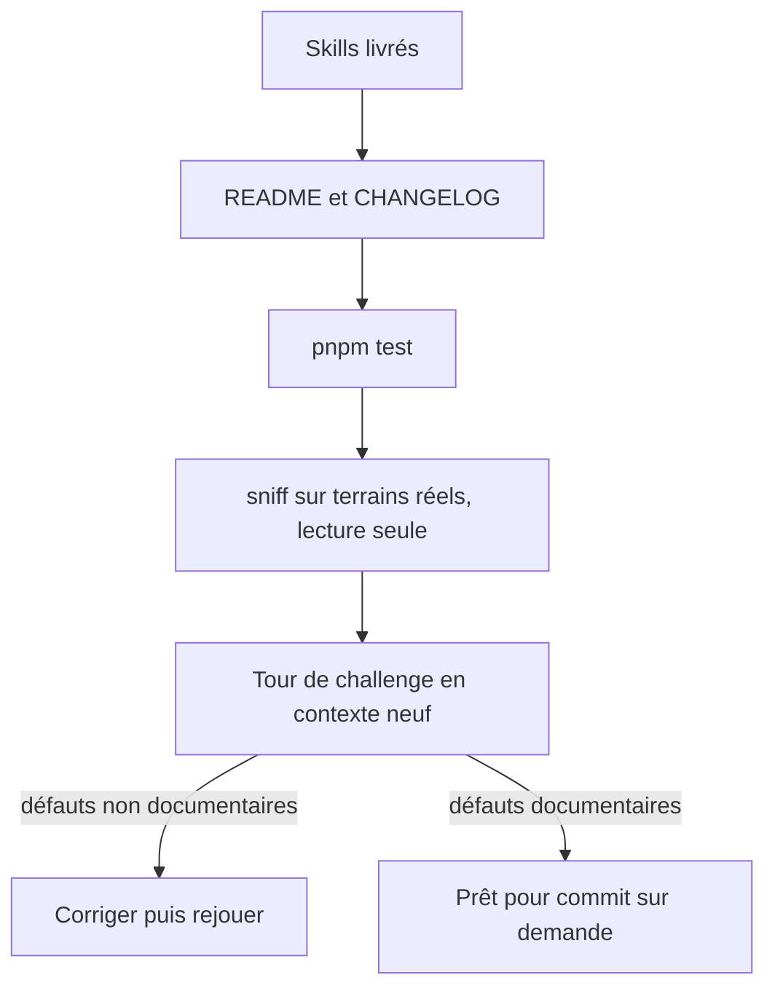
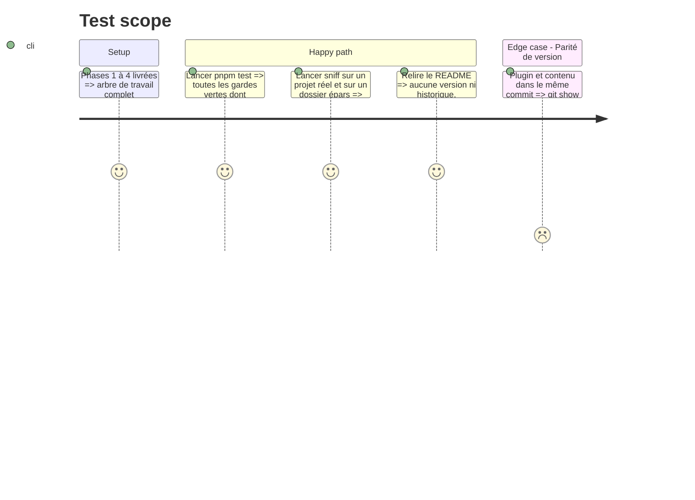

# Instruction: Documentation, vérification et challenge

## Architecture projection

> Tree of the final files. ✅ create · ✏️ modify · ❌ delete

```txt
.
├── README.md                          ✏️ ligne du tableau des plugins, ligne « Type de projet », ligne d'appel audit
├── CHANGELOG.md                       ✏️ [Unreleased] / Added : plugin sc-pwsh
└── plugins/sc-pwsh/
    ├── README.md                      ✅ existant uniquement : skills, pivot, absences déclarées
    └── CHANGELOG.md                   ✅ 0.1.0
```

## User Journey



## Test Scope



## Tasks to do

### `1)` Documentation

> Le README décrit ce qui existe, le CHANGELOG ce qui change.

1. `plugins/sc-pwsh/README.md` : table des skills (déclencheur, description), pivot de capacité, section « Absences déclarées » (testing, perf, data, cd, log-analysis) ; aucune version ni historique.
2. `plugins/sc-pwsh/CHANGELOG.md` : entrée 0.1.0.
3. `README.md` racine : ajouter `sc-pwsh` au tableau des plugins, au tableau « Type de projet », et `sc-pwsh:audit` à la ligne d'appel vers `aidd-dev:04-audit`.
4. `CHANGELOG.md` racine : une entrée `### Added` sous `[Unreleased]` ; ne pas bumper la version du marketplace.

### `2)` Vérification

> Les gardes, puis le terrain.

1. `pnpm test` : relever tout échec avec sa sortie.
2. `sniff` sur le projet de scripts réel et sur un dossier de `.ps1` épars : comparer au décompte de `measurements.md` ; comparer `git status --porcelain` avant et après.
3. Parité de version : quand le commit est demandé par l'utilisateur, plugin et contenu dans le même commit ; vérifier la parité sur `git show HEAD:` (`pnpm test` lit l'arbre de travail, pas l'état commité).

### `3)` Challenge

> Un juge qui ne partage pas le contexte.

1. Lancer `aidd-refine:02-challenge` sur le plugin en contexte neuf.
2. Corriger les défauts non documentaires, rejouer `pnpm test`. S'arrêter quand ne subsistent que des défauts documentaires.

## Test acceptance criteria

| Task | Acceptance criteria                                                                                                           |
| ---- | ----------------------------------------------------------------------------------------------------------------------------- |
| 1    | Aucune version ni historique dans les README ; le `CHANGELOG.md` racine porte l'ajout sous `[Unreleased]`, version du marketplace inchangée. |
| 2    | `pnpm test` exit 0 ; `sniff` ne modifie aucun fichier des terrains ; l'arbre de travail ne contient que les fichiers listés dans les projections des cinq phases. |
| 3    | Le rapport de challenge ne laisse aucun défaut non documentaire ouvert.                                                       |
