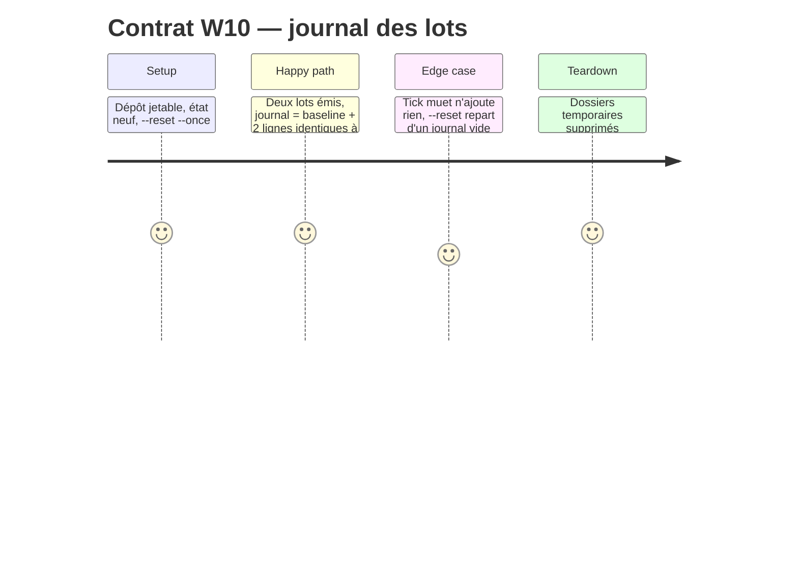

# Phase 1 — Journal des lots dans la sonde

## Architecture projection

```
watch.sh tick()
  ├─ baseline  ──► stdout + $state/emitted.log   (--reset vide le journal)
  ├─ batch #k  ──► stdout + $state/emitted.log
  └─ idle Ns   ──► stdout + $state/emitted.log
```

Une fonction `emit` remplace les trois `echo` : `printf '%s\n' "$1" | tee -a "$state/emitted.log"`.

## User Journey

Le commentateur reçoit `batch #269` alors qu'il a commenté #234 en dernier. Il lit `emitted.log` et y trouve #235 à #268.

## Test Scope



## Wireframe

Sans objet (aucune interface).

## Tasks to do

- [x] `watch.sh` : ajouter `emit()` et l'utiliser aux trois points d'émission (lignes 108, 154, 157)
- [x] `watch.sh` : documenter `emitted.log` dans l'en-tête (liste de l'état persistant, ligne 28), puis **ajuster la plage de `--help`** (`sed -n '2,29p'`, ligne 42) à la nouvelle fin de l'en-tête
- [x] `--reset` vide déjà le journal (`rm -rf "$state"`, ligne 51) : aucun code, seulement couvert par W10
- [x] `tools/eval/control-watch.mjs` : ajouter W10 (journal = concaténation exacte des sorties non vides ; tick muet sans ajout ; `--reset` le vide)
- [x] Vérifier que W1 à W9 restent verts : `node tools/eval/control-watch.mjs`

## Test acceptance criteria

- `node tools/eval/control-watch.mjs` : W1 à W10 verts
- Le journal est identique, ligne pour ligne, à ce que stdout a émis
- Aucun fichier écrit dans le dépôt observé (W7 inchangé)
- `watch.sh --help` affiche tout l'en-tête, et rien du code
