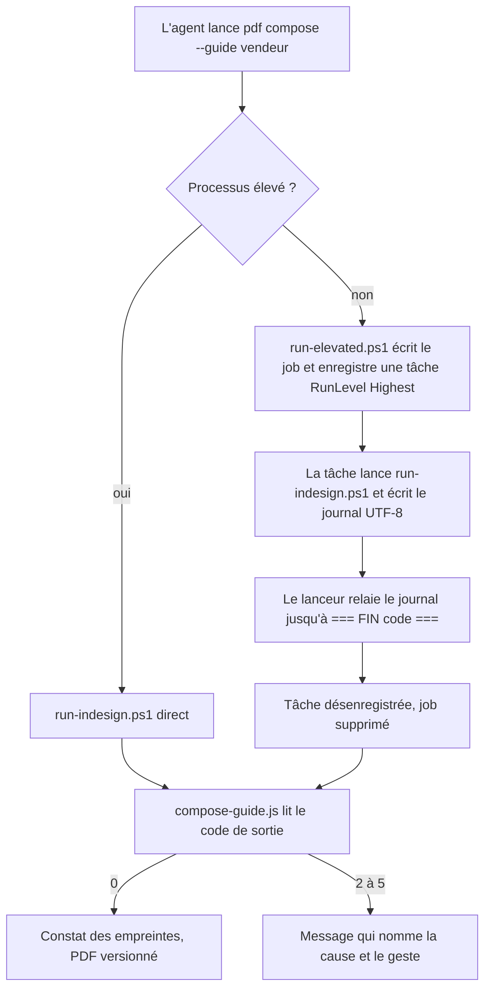
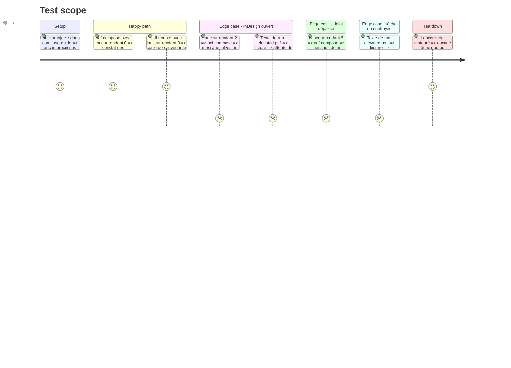

# Instruction: Lanceur InDesign par tâche planifiée et méthode générique (0.3.0)

## Architecture projection

> Fichiers en fin de phase. ✅ créer · ✏️ modifier · ❌ supprimer

```txt
.claude-plugin/marketplace.json                 ✏️ doc-pdf 0.3.0 (règle M1)
plugins/doc-pdf/
├── .claude-plugin/plugin.json                  ✏️ 0.3.0
├── .codex-plugin/plugin.json                   ✏️ 0.3.0 (resté à 0.2.0)
├── CHANGELOG.md                                ✏️ entrée 0.3.0
├── README.md                                   ✏️ prérequis : plus de PowerShell administrateur
├── skills/doc-pdf/SKILL.md                     ✏️ l'agent lance `pdf` lui-même, après accord
├── references/runbook-export-indesign.md       ✏️ réécrit en termes génériques, section « Lancer InDesign »
└── engine/
    ├── compose-guide.js                        ✏️ launch() passe par run-elevated.ps1, code de sortie relayé
    ├── export-icml.js                          ✏️ message PANDOC_MISSING (l. 81) et en-tête (l. 6-13, 363)
    ├── build-idml-template.js                  ✏️ en-tête d'usage (l. 9-14, 289, 1365)
    ├── build-merged-guides.js                  ✏️ en-tête, bannière BANNER et message de --check (l. 6-7, 27-29, 142)
    ├── icml-pages.js                           ✏️ commentaire (l. 3)
    ├── indesign/
    │   ├── run-indesign.ps1                    ✏️ commentaire d'en-tête (l. 11)
    │   └── run-elevated.ps1                    ✅ tâche planifiée, attente, journal, nettoyage
    └── tests/
        ├── compose-guide.unit.test.js          ✏️ lanceur injecté, codes 2 à 5 relayés
        ├── run-elevated.unit.test.js           ✅ contrat du script lu en texte
        ├── icml-transform.unit.test.js         ✏️ l. 590-607 suit la nouvelle section des styles ; mention de scripts/guides
        ├── build-merged-guides.unit.test.js    ✏️ bannière attendue (l. 54)
        ├── export-icml.unit.test.js            ✏️ mentions de scripts/guides et de pnpm run guides
        ├── guide-config.unit.test.js           ✏️ idem
        ├── icml-manifest.unit.test.js          ✏️ idem
        ├── icml-pages.unit.test.js             ✏️ idem
        └── fixtures/project/docs/
            ├── guide-administrateur/Guide administrateur.md   ✏️ bannière régénérée par merge
            └── guide-partenaire/guide client.md               ✏️ bannière régénérée par merge

Code/Pro/cerascan/aidd_docs/guides/              (commit séparé, dans le dépôt cerascan, sur demande)
├── guide-administrateur/Guide administrateur.md ✏️ bannière régénérée par merge
└── guide-partenaire/guide client.md             ✏️ bannière régénérée par merge
```

## User Journey



## Test Scope



## Tasks to do

### `1)` Partir d'un arbre propre

> La version 0.3.0 se pose sur une 0.2.3 commitée.

1. Lire `git status --short` dans le Marketplace.
2. Si les 7 fichiers de la 0.2.3 ne sont pas commités, s'arrêter et demander à l'utilisateur de décider du commit.

### `2)` Lanceur élevé `run-elevated.ps1`

> Lancer `run-indesign.ps1` en administrateur sans terminal ouvert à la main, et rendre son code de sortie.

1. Paramètres : `-Script`, `-ArgsJson`, `-TimeoutMinutes` (60 par défaut).
2. Déjà élevé : appeler `run-indesign.ps1` directement et rendre son code.
3. Sinon, écrire `-ArgsJson` dans un fichier de job sous `%TEMP%`. Le JSON ne passe jamais dans la ligne de commande de la tâche, à cause des guillemets et de la longueur.
4. Enregistrer une tâche au nom unique `doc-pdf-<pid>-<horodatage>` (`RunLevel Highest`, `LogonType Interactive`). Elle relance ce même script en mode interne sur le job.
5. Mode interne : lancer `run-indesign.ps1`, écrire sa sortie en UTF-8 dans le journal du job, finir par `=== FIN <code> ===`.
6. Mode externe : relayer les nouvelles lignes du journal jusqu'au marqueur, puis rendre le code lu.
7. Délai dépassé : code 5, message qui donne le chemin du journal.
8. Dans un `finally` : désenregistrer la tâche et supprimer le job. Garder le journal en cas d'échec.
9. Avant de rendre la main, sauf sur le code 2 (InDesign déjà ouvert par l'utilisateur, que `run-indesign.ps1` ne ferme pas), attendre la fin du processus InDesign (60 s au plus), sans le tuer. Sinon la commande suivante tombe en code 2.

### `3)` Brancher `compose-guide.js`

> `pdf update` et `pdf compose` passent par le lanceur élevé et distinguent les causes d'échec.

1. `launch()` (l. 317) appelle `run-elevated.ps1` à la place de `run-indesign.ps1`.
2. Rendre le code tel quel au lieu de le ramener à 0 ou 1. Chaque code 2 à 5 reçoit un message qui nomme la cause et le geste.
3. Rendre le lanceur injectable pour les tests, sans changer la signature de la CLI.

### `4)` Runbook générique

> Une méthode écrite une fois, applicable à tout projet et à toute maquette.

1. Retirer `pnpm run guides:*`, `scripts/guides/`, `aidd_docs/` et les trois guides cerascan. Les remplacer par `node <racine du plugin>/engine/cli.js …` et par « chaque guide de la configuration ».
2. Corriger les identifiants qui n'existent pas dans le code : `COVER_TYPE` → `DEFAULT_TYPE`, ainsi que `GUIDE_AXES`, `GUIDE_VERBS` et `GUIDE_LABELS`, remplacés par les champs `accent`, `verb` et `title` de la configuration.
3. Supprimer la phrase « coordonnées encore À renseigner », propre à cerascan.
4. Ajouter une section « Lancer InDesign » : tâche planifiée, journal, codes 0, 2, 3, 4 et 5, InDesign fermé entre deux commandes.
5. Garder intacte la section « 2. Styles à créer » (l. 61-121), que le test `icml-transform` (l. 590-607) compare à `STYLE_TABLE`.

### `5)` Messages et documentation du moteur

> Plus aucune mention du dépôt cerascan dans le moteur.

1. Réécrire les en-têtes et les messages des fichiers listés dans la projection en `node <racine du plugin>/engine/cli.js <commande>`.
2. La bannière `BANNER` de `build-merged-guides.js` (l. 27-29) dit : « Fichier généré par la commande merge du plugin doc-pdf à partir des fichiers 0*.md de ce dossier. Ne pas modifier : éditer les fichiers numérotés puis relancer merge. » Elle ne nomme aucun chemin de poste. Le message de `--check` (l. 142) renvoie à la même commande.
3. Mettre à jour les tests listés dans la projection : la bannière attendue (`build-merged-guides.unit.test.js:54`) et les mentions de `scripts/guides` et de `pnpm run guides`.
4. Régénérer les deux fixtures fusionnées par `merge --config engine/tests/fixtures/project/docs/documentation.config.json`, sans les éditer à la main.
5. Dans cerascan, régénérer les deux guides fusionnés par `node <racine du plugin>/engine/cli.js merge --config aidd_docs/guides/documentation.config.json`. Seule la ligne 1 doit changer (`git diff --stat`). Le commit cerascan attend la demande de l'utilisateur.
6. `SKILL.md` (l. 47) : l'agent lance `pdf` lui-même, après l'accord de l'utilisateur, document fermé.
7. `README.md` (l. 14) : InDesign seul en prérequis.

### `6)` Bump 0.3.0

> Version et notes cohérentes dans les trois manifestes.

1. Mettre `plugin.json`, `.codex-plugin/plugin.json` et `marketplace.json` à 0.3.0, avec la même description.
2. Écrire l'entrée 0.3.0 du CHANGELOG : lanceur élevé, codes de sortie, runbook générique.
3. Lancer `node tools/eval/consistency.mjs` et la suite Jest du moteur.

### `7)` Composition réelle

> Prouver le lanceur sur InDesign, après accord de l'utilisateur.

1. Depuis un processus non élevé, lancer `pdf compose --guide vendeur --remplacer` sur cerascan.
2. Constater dans le Planificateur qu'aucune tâche `doc-pdf-*` ne reste.
3. Relever le préréglage d'export retenu par l'heuristique, que nomme la ligne `PDF : … (préréglage …)` du rapport (`compose-guide.jsx:745`). La phase 3 l'inscrit dans la maquette Scriptami.
4. Chemin d'échec, après un nouvel accord : InDesign ouvert à la main, relancer la même commande. Elle rend le code 2 (`run-indesign.ps1`, l. 22-24) avec le message de la tâche 3.2, et le Planificateur ne garde aucune tâche `doc-pdf-*`. Fermer InDesign ensuite.

### `8)` Commit de référence

> La phase 2 compare son moteur à celui de cette phase : il lui faut un commit.

1. Demander à l'utilisateur le commit de fin de phase dans le Marketplace (et celui de cerascan pour les guides fusionnés).
2. Noter le SHA du commit Marketplace dans le compte rendu de la phase. La phase 2 ne démarre pas sans lui.

## Test acceptance criteria

| Task | Acceptance criteria |
| ---- | ------------------- |
| 1 | La phase ne démarre que sur un Marketplace où la 0.2.3 est commitée. |
| 2 | Un script lancé hors élévation rend le code de `run-indesign.ps1`. Le journal s'affiche pendant l'exécution. Aucune tâche ne reste après un succès ni après un échec (constatés en tâche 7) ; pour le délai dépassé, le test sur le texte du script prouve que le désenregistrement se fait dans un `finally`. Ce même test prouve que l'attente de la fin d'InDesign est sautée sur le code 2. |
| 3 | Avec un lanceur simulé, chaque code 2 à 5 produit un message distinct et aucun PDF annoncé ; le code 0 produit le constat des empreintes. |
| 4 | Le runbook ne cite ni `pnpm run guides`, ni `scripts/guides`, ni `aidd_docs`, ni un identifiant absent du code ; le test `icml-transform` des styles reste vert. |
| 5 | Une recherche de `scripts/guides` et de `pnpm run guides` dans `engine/` ne trouve plus rien, fixtures et tests compris ; `merge --check` est vert sur la fixture et sur cerascan, dont seule la ligne 1 des deux guides fusionnés a changé. |
| 6 | `consistency.mjs` est vert et la suite Jest du moteur est verte. |
| 7 | Le PDF du guide vendeur est produit sans terminal administrateur, le nom du préréglage d'export est relevé dans le compte rendu de la phase, InDesign ouvert fait rendre le code 2, et le Planificateur ne garde aucune tâche `doc-pdf-*` après ces deux passages. |
| 8 | Le compte rendu de la phase porte le SHA du commit de fin de phase du Marketplace. |

## Compte rendu

- Commit de fin de phase (Marketplace, feat/maquettes-doc-pdf) : a8d9e60. Commit cerascan (guides fusionnés) : 4319f43.
- Préréglage d export retenu par l heuristique : [Qualité supérieure] (à inscrire dans la maquette en phase 3).
- Composition réelle : guide vendeur, 23 pages, PDF produit sans terminal administrateur, aucune tâche doc-pdf résiduelle. Le test du code 2 (InDesign ouvert) n a pas été joué ; il est couvert par le test sur le texte du script.
