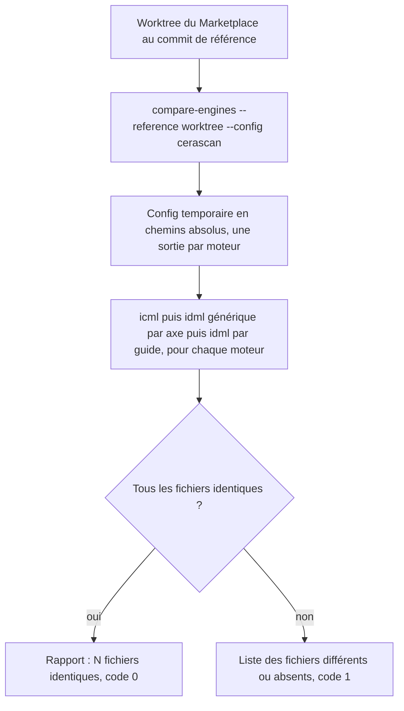
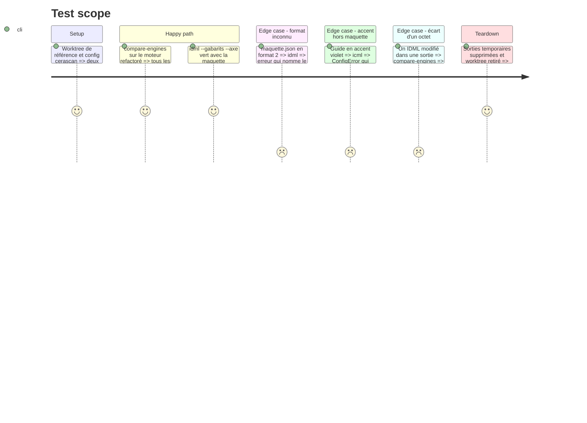

# Instruction: Banc de comparaison, format de maquette 1 et chargeur (grille, nuancier, polices)

## Architecture projection

> Fichiers en fin de phase. ✅ créer · ✏️ modifier · ❌ supprimer

```txt
plugins/doc-pdf/engine/
├── maquette.js                              ✅ loadMaquette() : lecture, format 1, champs requis, MaquetteError
├── maquettes/scriptami/maquette.json        ✅ format 1 : page, entête et pied, couleurs, axes, polices, langue
├── tools/compare-engines.js                 ✅ banc : deux moteurs, mêmes sources, sorties comparées octet pour octet
├── guide-config.js                          ✏️ champ `maquette` facultatif (défaut transitoire : maquettes/scriptami), chargé par loadMaquette dans config.maquette, ACCENTS (l. 34) lus dans les axes
├── build-idml-template.js                   ✏️ PAGE, MARGINS, COLUMNS (l. 42-44), en-tête et pied (l. 417-430), COLORS, AXES, AXIS_TONES, DEFAULT_AXIS (l. 47-69), polices (l. 92-99), langue (l. 319) ; main (l. 1397-1411) : maquette chargée avant de valider --axe (l. 1373, 1386), passée à buildIdml
└── tests/
    ├── maquette.unit.test.js                ✅ format inconnu, champ manquant, chemin introuvable
    ├── compare-engines.unit.test.js         ✅ deux arbres identiques, un octet différent, un fichier en trop
    └── guide-config.unit.test.js            ✏️ accent hors des axes de la maquette refusé
```

## User Journey



## Test Scope



## Tasks to do

### `1)` Banc de comparaison `tools/compare-engines.js`

> Prouver que chaque refactorisation laisse les sorties cerascan identiques octet pour octet, sans rien stocker.

1. Paramètres : `--reference <racine d'un moteur>`, `--config <documentation.config.json>`, `--garder` (conserve les sorties pour inspection).
2. Pour chaque moteur, écrire une configuration temporaire dans le scratchpad. Rien n'est écrit dans le dépôt client.
   - Lire la configuration d'origine et résoudre chaque chemin depuis son propre dossier, comme `resolveConfig` (`guide-config.js:101-123`) : `sourceDir`, `pagesFile`, `maquette` s'il est présent, le `document` de chaque guide, et `versionFile`.
   - Résoudre `versionFile` absent comme le moteur, par `findUp` du `package.json` depuis le dossier de la configuration d'origine. Sans cette écriture, le scratchpad n'a aucun `package.json` au-dessus de lui et `readVersion` lève une erreur.
   - Écrire tous ces chemins en absolu. Seul `outputDir` diffère d'un moteur à l'autre : un dossier par moteur dans le scratchpad.
   - Recopier telles quelles les autres clés (`guides`, `pdfPreset`).
3. Lancer `icml`, puis `idml --gabarits --axe <axe>` pour chaque axe, puis `idml --guide <id>` pour chaque guide. La liste des axes est celle de la maquette chargée par le moteur courant (`loadMaquette`), passée telle quelle au moteur de référence : un axe que la référence refuse fait échouer sa commande, et le banc le rapporte comme un écart. Chaque commande reçoit `--config <configuration temporaire du moteur>` : sans elle, `idml --gabarits` écrirait dans le `output/` du dossier courant (`build-idml-template.js`, l. 1399).
4. Comparer les deux arbres octet pour octet. `.manifest.json` est comparé lui aussi.
5. Rapporter le nombre de fichiers identiques, les fichiers différents et ceux qui manquent d'un côté. Code 0 si tout est identique, 1 sinon.
6. Référence : `git worktree add --detach <scratchpad>/ref <SHA de fin de phase 1>`, le SHA relevé dans le compte rendu de la phase 1. S'arrêter s'il manque. Le moteur ne charge que des modules intégrés de Node : aucune jonction `node_modules`. Retirer le worktree par `git worktree remove` à la fin.

### `2)` Format 1 et chargeur `maquette.js`

> Le moteur lit une maquette décrite en données et refuse ce qu'il ne connaît pas.

1. `maquette.json` porte `format: 1` et `nom` (« scriptami »), ainsi que les blocs `page`, `entetePied`, `couleurs`, `axes` (tons et axe par défaut), `polices` et `langue`.
2. `loadMaquette(dossier)` vérifie le format puis chaque bloc requis. L'erreur nomme le champ et le chemin du fichier.
3. Le résultat est figé (`Object.freeze` en profondeur) : aucune fonction du moteur ne le modifie.
4. Ne rien prévoir pour les formats futurs, pas même de migration : un format inconnu est refusé.

### `3)` Configuration

> La maquette se désigne dans la configuration et décide des accents permis.

1. `guide-config.js` lit `maquette`, un chemin relatif au fichier de configuration.
2. Si le champ est absent, prendre `engine/maquettes/scriptami` : défaut transitoire, retiré en phase 4 avec le départ de Scriptami. Le moteur de référence ignore les clés inconnues (`resolveConfig`, `guide-config.js:101-123`) : une configuration portant `maquette` reste lisible des deux côtés du banc.
3. `resolveConfig` (l. 101-123) charge la maquette par `loadMaquette` et l'expose dans `config.maquette`. Tous les consommateurs la lisent là, sans la recharger. Conséquence assumée : `merge` charge aussi la maquette.
4. `ACCENTS` (l. 34) disparaît : un `accent` de guide est validé contre les axes de `config.maquette`. La `ConfigError` nomme le guide et les axes permis.

### `4)` Grille, nuancier et polices lus dans la maquette

> Les valeurs de cette phase quittent le code sans changer un octet des sorties.

1. `build-idml-template.js` : les constantes listées dans la projection deviennent des lectures de la maquette, que `buildIdml` (l. 1411) reçoit en paramètre.
2. `main` (l. 1397-1400) prend `config.maquette` quand une configuration est lue (`--guide` ou `--config`), sinon le défaut transitoire par `loadMaquette`. `--axe` est validé après ce chargement, contre les axes de la maquette, avec un message qui les liste (l. 1373, 1386). L'axe par défaut (l. 1400) vient de la maquette.
3. Garder l'option `--police-puce` (l. 287) : elle prend le pas sur la police de puce de la maquette.
4. `icml-transform.js` ne change pas : `Color/Paper` est la nuance Papier native d'InDesign (`build-idml-template.js`, l. 379), pas une valeur de charte. Les attributs qui la citent partent avec `STYLE_TABLE` en phase 3.
5. Laisser en place les couleurs fixes hors axe (l. 173-174, 891-893, 972) : elles partent avec les gabarits en phase 3.
6. Les tests existants restent verts sans changer leurs valeurs : ils lisent la maquette embarquée.

### `5)` Preuve

> La phase ne se clôt que sur un banc vert.

1. Lancer `compare-engines` sur `cerascan/aidd_docs/guides/documentation.config.json`.
2. Lancer la suite Jest du moteur.
3. Demander à l'utilisateur le commit de fin de phase et noter son SHA dans le compte rendu. La phase 3 ne démarre pas sans lui.

## Test acceptance criteria

| Task | Acceptance criteria |
| ---- | ------------------- |
| 1 | Sur deux moteurs identiques, le banc rend 0 et compte tous les ICML et IDML ; un octet modifié le fait rendre 1 en nommant le fichier ; une configuration sans `versionFile` passe le banc ; le dossier `output/` de cerascan n'est pas touché. |
| 2 | Une maquette en format 2, sans `axes` ou introuvable produit une erreur qui nomme le champ ou le format et le fichier, sans aucune sortie écrite. |
| 3 | Un guide dont l'accent n'est pas un axe de la maquette est refusé avec la liste des axes ; sans champ `maquette`, la sortie reste celle de Scriptami. |
| 4 | Une recherche des valeurs hexadécimales et des noms de police de la maquette dans `build-idml-template.js` ne trouve plus que les couleurs fixes laissées pour la phase 3. |
| 5 | `compare-engines` rend 0 sur les sources cerascan, la suite Jest est verte, et le compte rendu porte le SHA du commit de fin de phase. |

## Compte rendu

- Banc `tools/compare-engines.js` : référence = worktree au SHA `a8d9e60` (fin de phase 1), moteur courant, configuration cerascan. Résultat : 273 fichiers identiques octet pour octet, `.manifest.json` compris, code 0. Worktree retiré, `output/` de cerascan non touché.
- Le banc a servi : une première passe a révélé six IDML différents (`${LANGUAGE}` resté littéral dans `Styles.xml`, chaîne à guillemets simples). Corrigé en gabarit de chaîne, banc rejoué au vert.
- Jest : 13 suites, 377 tests verts (ajouts : `maquette.unit.test.js`, `compare-engines.unit.test.js`).
- Critère 4 : la recherche des hexadécimaux et noms de police ne trouve plus que les couleurs fixes hors axe (`Paper`, `Attention fond`, `Papier chaud`, `Orange vif`), laissées pour la phase 3, et la police de puce par défaut citée en commentaire d'aide.
- Commit de fin de phase (Marketplace, feat/maquettes-doc-pdf), phases 1 et 2 : 6ff1d07.
