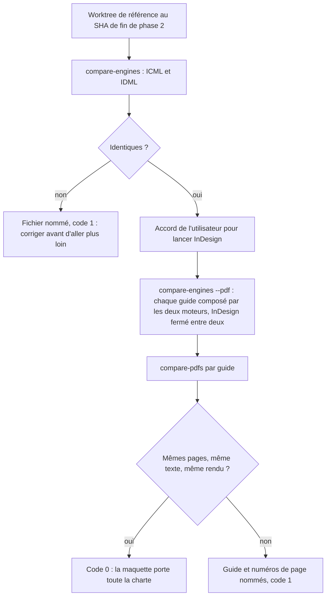
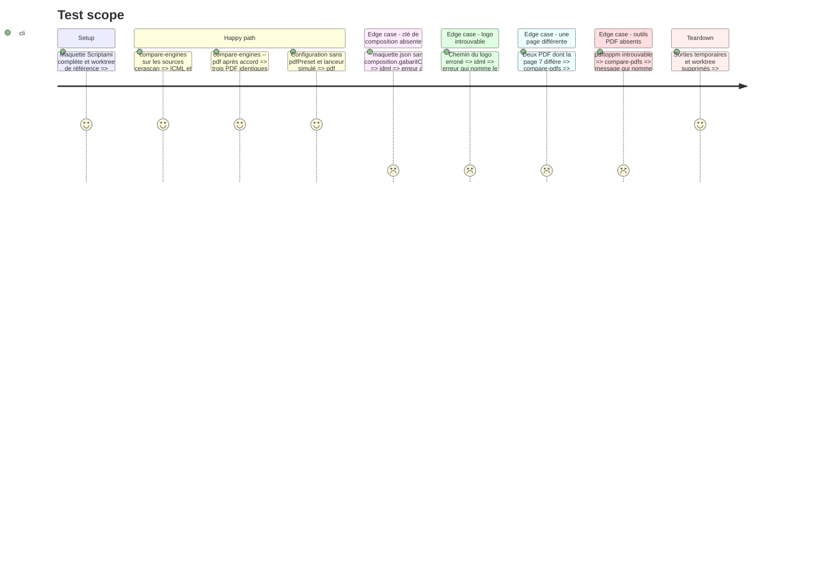

# Instruction: Gabarits, styles, textes, logo, composition et export dans la maquette

## Architecture projection

> Fichiers en fin de phase. ✅ créer · ✏️ modifier · ❌ supprimer

```txt
plugins/doc-pdf/engine/
├── maquette.js                              ✏️ format 1 complet : gabarits, cadres, variables, textes, styles, libellés, composition, export, logo
├── maquettes/scriptami/
│   ├── maquette.json                        ✏️ blocs ajoutés, préréglage relevé en phase 1
│   └── logo.svg                             ✅ tracés du logotype (ex-WORDMARK_PATHS)
├── build-idml-template.js                   ✏️ FORMATS (l. 127-253), CHARTER_ONLY (l. 256-262), MASTERS (l. 435-440), TEXT_VARIABLES (l. 444-449), noms de cadres (l. 674-978, 1222-1271), textes fixes, couleurs fixes (l. 173-174, 891-893, 972), préfixe d'outputPathFor (l. 1357-1359) ; styles lus dans la maquette au lieu de require STYLE_TABLE (l. 24, 354) ; guidePages (l. 1404) reçoit la maquette
├── icml-transform.js                        ✏️ STYLE_TABLE (l. 45-127) et son export (l. 757) retirés, libellés (l. 130, 427, 441-446), typographie (l. 353-360) ; transformIcml (l. 693) et buildPageIcml (l. 743) reçoivent la maquette
├── icml-pages.js                            ✏️ libellés (l. 22-23, 103-127), textes fixes du pied et des mentions (l. 125-209) ; fonctions de page et guidePages reçoivent la maquette
├── export-icml.js                           ✏️ config.maquette passée à transformIcml (l. 280, par exportGuides l. 297 et convertChapter l. 276), à buildPageIcml et aux fonctions de icml-pages.js (convertCommon l. 223-233, convertPages l. 241-262)
├── logo-scriptami.js                        ✏️ ne garde que parseSvgPath (l. 126-201) et la lecture du SVG de la maquette
├── compose-guide.js                         ✏️ membre `composition` et préréglage dans le JSON transmis, nom du modèle (l. 99, 167)
├── indesign/
│   ├── compose-guide.jsx                    ✏️ constantes (l. 29-45), OPENING_FILES, SATELLITE_FRAMES, HEADER_FILES (l. 16-27), 'Courante' (l. 692-693) lus dans paths.composition
│   ├── compose-chapter.jsx                  ✏️ 'Courante' (l. 58), préréglage transmis (l. 64)
│   ├── update-document.jsx                  ✏️ 'Courante' (l. 117)
│   └── compose-lib.jsx                      ✏️ pdfPreset : heuristique gardée en dernier repli
├── tools/
│   ├── compare-pdfs.js                      ✅ texte et rendu de chaque page, comparés page par page
│   └── compare-engines.js                   ✏️ option --pdf : compose chaque guide avec les deux moteurs
└── tests/
    ├── maquette.unit.test.js                ✏️ blocs complets, clé de composition manquante, logo introuvable
    ├── build-idml-template.unit.test.js     ✏️ valeurs attendues inchangées, styles lus dans la maquette embarquée (l. 3, 104-141)
    ├── icml-transform.unit.test.js          ✏️ maquette embarquée passée aux appels ; styles lus dans la maquette (l. 10, 575-589) ; runbook comparé aux styles de la maquette (l. 590-607)
    ├── icml-pages.unit.test.js              ✏️ styles connus lus dans la maquette embarquée (l. 32, 309), maquette passée aux fonctions de page
    ├── logo-scriptami.unit.test.js          ✏️ tracés lus dans logo.svg
    ├── compose-guide.unit.test.js           ✏️ composition et préréglage transmis, ordre de priorité du préréglage
    └── compare-pdfs.unit.test.js            ✅ PDF identiques, une page différente, nombre de pages différent
```

## User Journey



## Test Scope



## Tasks to do

### `1)` Compléter le format 1

> La maquette porte toute la charte. Le format 1 n'est publié qu'en 0.4.0 : le compléter ici ne crée pas de format 2.

1. Ajouter à `maquette.json` les blocs suivants :
   - `styles` : définitions du modèle (`FORMATS`, `CHARTER_ONLY`), correspondance Markdown → InDesign (`STYLE_TABLE`) avec le rendu des callouts, réglages typographiques d'`icml-transform.js` (l. 353-360) ;
   - `gabarits` : `MASTERS` et nom du gabarit du corps (`Courante`) ;
   - `cadres` : noms des cadres du modèle, avec les correspondances `OPENING_FILES`, `SATELLITE_FRAMES` et `HEADER_FILES` ;
   - `variables` : `TEXT_VARIABLES` ;
   - `textes` : textes fixes du modèle et des pages communes ;
   - `libelles` : une seule entrée par libellé (« p. … », « Sommaire », « Dans ce chapitre »), aujourd'hui recopiés dans plusieurs fichiers ;
   - `composition` : constantes de `compose-guide.jsx` (l. 29-45) ;
   - `export` : `preset`, le préréglage relevé en phase 1 ;
   - `logo` : chemin relatif vers `logo.svg`.
2. `loadMaquette` vérifie chaque bloc et chaque clé de `composition`. Une clé oubliée ne doit jamais arriver dans InDesign sous la forme `undefined`.
3. `logo.svg` reprend tels quels les attributs `d` de `WORDMARK_PATHS` (`logo-scriptami.js`, l. 14-24). Le tracé lu doit donner les mêmes nombres que les constantes.

### `2)` Modèle IDML lu dans la maquette

> `build-idml-template.js` ne garde plus aucune valeur de charte.

1. Remplacer par des lectures de la maquette les constantes et les textes listés dans la projection, couleurs fixes comprises.
2. `outputPathFor` tire son préfixe (`scriptami-<accent>.idml`) du champ `nom` de la maquette. `compose-guide.js` (l. 99, 167) lui passe la maquette chargée.
3. `logo-scriptami.js` ne garde que `parseSvgPath` et la lecture des tracés du fichier désigné par la maquette.

### `3)` ICML lus dans la maquette

> La correspondance des styles et les libellés viennent de la maquette.

1. `transformIcml` (l. 693) et `buildPageIcml` (l. 743) reçoivent la maquette en option obligatoire. Ils y lisent la correspondance des styles, les libellés et la typographie. `STYLE_TABLE` et son export (l. 757) disparaissent. `cerascan_object_styles` (l. 138) ne change pas.
2. Les fonctions de page de `icml-pages.js` et `guidePages` reçoivent la maquette et y lisent les libellés ainsi que les textes fixes du pied et des mentions. Les valeurs du bloc `commun` de `pages-gabarit.json` restent dans le projet jusqu'en phase 4.
3. `export-icml.js` transmet `config.maquette` : `exportGuides` (l. 297) la passe à `convertChapter` (l. 276), puis à `transformIcml` (l. 280) ; `convertCommon` et `convertPages` (l. 223-262) la passent à `buildPageIcml` et aux fonctions de page. `build-idml-template.js` la passe à `guidePages` (l. 1404) et lit ses définitions de style dans la maquette (l. 24, 354).
4. Les tests qui importaient `STYLE_TABLE` lisent les styles de la maquette embarquée, chargée une fois par `loadMaquette` : `icml-transform.unit.test.js` (l. 10, 575-589), `icml-pages.unit.test.js` (l. 32, 309) et `build-idml-template.unit.test.js` (l. 3, 104-141). Leurs appels à `transformIcml`, `buildPageIcml` et aux fonctions de page reçoivent cette maquette.
5. Le test `icml-transform` (l. 590-607) compare la section « 2. Styles à créer » du runbook aux styles de la maquette embarquée.

### `4)` Composition et export pilotés par la maquette

> Les scripts InDesign ne portent plus aucune valeur de charte.

1. `compose-guide.js` ajoute le membre `composition` au JSON transmis à InDesign, dans le même objet que les chemins. `run-indesign.ps1` ne change pas.
2. `compose-guide.jsx` lit ses constantes, `OPENING_FILES`, `SATELLITE_FRAMES`, `HEADER_FILES` et le gabarit du corps dans `paths.composition`. Le code reste en ES3.
3. `compose-chapter.jsx` et `update-document.jsx` lisent le gabarit du corps de la même façon.
4. Préréglage transmis à toutes les commandes `pdf` : le `pdfPreset` du projet d'abord, puis l'`export.preset` de la maquette, puis l'heuristique de `compose-lib.jsx`. `compose-chapter.jsx` (l. 64) passe le préréglage au lieu de `null`. Un préréglage nommé mais absent d'InDesign arrête l'export, comme aujourd'hui.

### `5)` Comparateur de PDF `tools/compare-pdfs.js`

> Comparer deux PDF sans tenir compte de leurs métadonnées, qui changent à chaque export.

1. Paramètres : deux chemins de PDF.
2. Comparer le nombre de pages, le texte de chaque page (`pdftotext`) et son rendu (`pdftoppm -r 72 -gray`, images PGM comparées octet pour octet).
3. Rapporter les pages qui diffèrent et sur quoi (texte ou rendu). Code 0 si tout est identique, 1 sinon.
4. Si `pdftotext` ou `pdftoppm` manque, arrêter avec un message qui nomme l'outil (fourni par MiKTeX ou Poppler).

### `6)` Option `--pdf` du banc

> Prouver que les PDF ne bougent pas, après accord de l'utilisateur.

1. `compare-engines --pdf` lance `pdf compose --guide <id> --sortie <dossier temporaire du moteur>/<id>.indd` pour chaque guide, avec chaque moteur, l'un après l'autre.
2. Passer par le lanceur élevé de la phase 1 et attendre la fermeture d'InDesign entre deux compositions.
3. Ne jamais passer `--maj-pages` : le banc n'écrit rien dans le projet.
4. Lancer `compare-pdfs` sur chaque paire de PDF et inclure le résultat dans le rapport du banc.

### `7)` Preuve

> La phase ne se clôt que sur des sorties identiques à tous les étages.

1. `compare-engines` sur la configuration cerascan, avec la référence au SHA relevé dans le compte rendu de la phase 2 (s'arrêter s'il manque) : ICML et IDML identiques.
2. Après accord de l'utilisateur, contrôler le bruit : composer deux fois le même guide avec le moteur de référence, puis lancer `compare-pdfs` sur les deux PDF. S'il ne rend pas 0, s'arrêter et nommer la source de l'écart (date, variable de texte, rendu instable). Le comparateur doit l'écarter avant toute comparaison entre moteurs.
3. `compare-engines --pdf` : trois PDF identiques.
4. Suite Jest du moteur.
5. Demander à l'utilisateur le commit de fin de phase et noter son SHA dans le compte rendu. La phase 4 ne démarre pas sans lui.

## Test acceptance criteria

| Task | Acceptance criteria |
| ---- | ------------------- |
| 1 | Une maquette privée d'une clé de `composition`, de son logo ou d'un bloc requis est refusée avec le nom de la clé ou du fichier, avant tout lancement d'InDesign. |
| 2 | Une recherche des valeurs hexadécimales, des noms de police, des noms de cadres et des textes fixes de Scriptami dans `build-idml-template.js` ne trouve plus rien. |
| 3 | Une recherche de `STYLE_TABLE` dans `engine/` (code et tests) ne trouve plus rien ; le test du runbook reste vert ; chaque libellé n'est écrit qu'une fois, dans la maquette. |
| 4 | Une recherche de `'Courante'` et des constantes de composition dans `engine/indesign/` ne trouve plus rien ; un test prouve l'ordre de priorité du préréglage. |
| 5 | Deux PDF issus du même document rendent 0 ; une page modifiée rend 1 et nomme la page ; un nombre de pages différent est signalé. |
| 6 | Le banc compose les trois guides avec chaque moteur sans écrire dans `cerascan` ; aucune tâche `doc-pdf-*` ne reste. |
| 7 | Deux compositions du même guide par le même moteur rendent 0 avant toute comparaison entre moteurs ; ICML, IDML et PDF identiques sur les sources cerascan ; la suite Jest est verte ; le compte rendu porte le SHA du commit de fin de phase. |

## Compte rendu

- Format 1 complet (styles, formats, textes, nuances, gabarits, cadres, variables, composition, logo, picto, export) ; maquette obligatoire dans `transformIcml`, `buildPageIcml` et les fonctions de `icml-pages`. Le bloc `libelles` prévu est absorbé par `textes`.
- Preuve : Jest 424 verts ; `compare-engines` (référence au SHA `6ff1d07`) : 273 fichiers ICML/IDML identiques octet pour octet ; `compare-engines --pdf` (accord de l'utilisateur, InDesign fermé) : PDF administrateur, partenaire et vendeur identiques (pages, texte, rendu).
- Bruit : non mesuré séparément. Deux moteurs rendant des PDF identiques, le bruit de rendu est nul sur ces guides.
- Worktree de référence supprimé, aucune tâche `doc-pdf-*` restante.
- SHA du commit de fin de phase : SHA_A_REMPLACER
