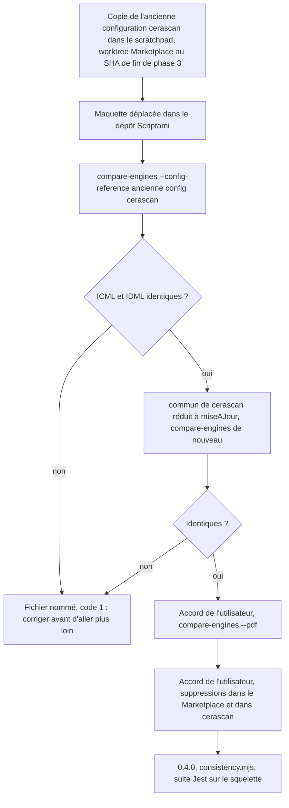
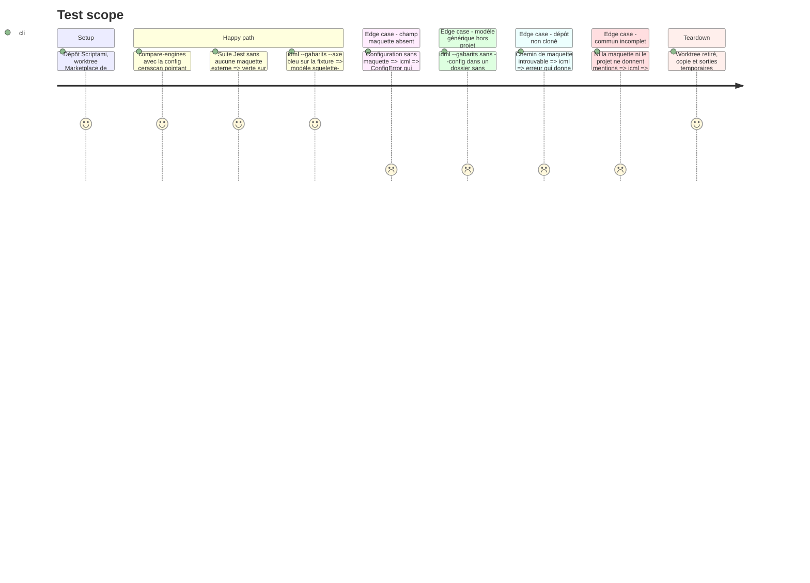

# Instruction: Dépôt Scriptami, squelette neutre et tests sur le squelette (0.4.0)

## Architecture projection

> Fichiers en fin de phase. ✅ créer · ✏️ modifier · ❌ supprimer (chaque ❌ attend l'accord de l'utilisateur)

```txt
Code/Perso/scriptami/maquette-doc-pdf/               ✅ dépôt git local, aucun distant sans accord
├── maquette.json                                    ✅ déplacé depuis engine/maquettes/scriptami, bloc `commun` ajouté
├── logo.svg                                         ✅ déplacé
├── charte.md                                        ✅ déplacé depuis cerascan (« Scriptami — Charte de mise en page des documentations PDF.md »)
├── gabarits.pdf                                     ✅ déplacé depuis cerascan (« Scriptami — gabarits de documentation PDF.pdf »)
└── README.md                                        ✅ désigner la maquette, source de la palette (wp-2026/design/tokens.json)

Marketplace/
├── .claude-plugin/marketplace.json                  ✏️ doc-pdf 0.4.0, description sans Scriptami (règle M1)
└── plugins/doc-pdf/
    ├── .claude-plugin/plugin.json                   ✏️ 0.4.0, description sans Scriptami
    ├── .codex-plugin/plugin.json                    ✏️ 0.4.0, description et longDescription sans Scriptami
    ├── CHANGELOG.md                                 ✏️ entrée 0.4.0 et note de migration
    ├── README.md                                    ✏️ moteur sans marque, champ `maquette`, squelette
    ├── skills/doc-pdf/SKILL.md                      ✏️ description et l. 21 : la maquette se désigne dans la configuration
    ├── references/runbook-export-indesign.md        ✏️ plus aucune valeur Scriptami, styles du squelette
    └── engine/
        ├── maquettes/scriptami/                     ❌ parti dans le dépôt Scriptami
        ├── maquettes/squelette/
        │   ├── maquette.json                        ✅ format 1 complet, polices de Windows, deux axes neutres
        │   └── logo.svg                             ✅ tracé neutre
        ├── maquette.js                              ✏️ bloc `commun` facultatif
        ├── guide-config.js                          ✏️ champ `maquette` obligatoire, défaut transitoire retiré
        ├── icml-pages.js                            ✏️ loadPagesConfig (l. 173) reçoit la maquette : `commun` de la maquette complété clé par clé par celui du projet avant la validation (l. 185), champ `miseAJour`
        ├── export-icml.js                           ✏️ config.maquette passée à loadPagesConfig (l. 305)
        ├── logo-scriptami.js                        ❌ renommé logo.js
        ├── logo.js                                  ✅ parseSvgPath et lecture du logo de la maquette
        ├── build-idml-template.js                   ✏️ commentaires (l. 3, 9, 671), require('./logo') (l. 28, seul importeur du module) ; main (l. 1397) : configuration toujours lue, défaut transitoire retiré
        ├── cli.js                                   ✏️ en-tête (l. 3), `init --maquette` obligatoire (CONFIG_TEMPLATE, l. 35-50)
        ├── icml-transform.js                        ✏️ en-tête (l. 3)
        ├── package.json                             ✏️ description (l. 5)
        ├── indesign/compose-guide.jsx               ✏️ commentaires (l. 33, 282)
        ├── tools/compare-engines.js                 ✏️ option --config-reference
        └── tests/
            ├── fixtures/project/docs/
            │   ├── documentation.config.json        ✏️ `maquette` vers maquettes/squelette, accents du squelette
            │   └── pages-gabarit.json               ✏️ pied sans « scriptami »
            ├── logo-scriptami.unit.test.js          ❌ renommé logo.unit.test.js
            ├── logo.unit.test.js                    ✅ tracés du squelette
            ├── build-idml-template.unit.test.js     ✏️ valeurs du squelette
            ├── icml-pages.unit.test.js              ✏️ exemples neutres, fusion du `commun`, `miseAJour`
            ├── icml-transform.unit.test.js          ✏️ runbook comparé aux styles du squelette
            ├── compose-guide.unit.test.js           ✏️ nom de modèle tiré du squelette ; `maquette` et accent du squelette dans les resolveConfig (l. 12, 112, 157, 188)
            ├── guide-config.unit.test.js            ✏️ champ `maquette` absent refusé ; valid() (l. 40-44) vers le squelette, axes attendus (l. 119-120)
            ├── cli.unit.test.js                     ✏️ init sans --maquette refusé, chemin relatif et accent écrits ; --maquette passé aux init existants (l. 70, 75)
            └── maquette.unit.test.js                ✏️ squelette valide, `commun` facultatif

Code/Pro/cerascan/                                   (commit séparé, dans le dépôt cerascan)
├── aidd_docs/guides/documentation.config.json       ✏️ "maquette": "../../../../Perso/scriptami/maquette-doc-pdf"
├── aidd_docs/guides/pages-gabarit.json              ✏️ `commun` réduit à `miseAJour`
├── aidd_docs/guides/Scriptami — Charte…md           ❌ parti dans le dépôt Scriptami
├── aidd_docs/guides/Scriptami — gabarits…pdf        ❌ parti dans le dépôt Scriptami
└── aidd_docs/memory/codebase-map.md                 ✏️ maquette externe, plus de « charte Scriptami » dans le plugin
```

## User Journey



## Test Scope



## Tasks to do

### `1)` Dépôt Scriptami

> La charte de l'auteur vit hors du plugin et hors des projets clients.

1. Créer `Code/Perso/scriptami/maquette-doc-pdf/` et l'initialiser par `git init`. Ne créer aucun dépôt distant sans l'accord de l'utilisateur.
2. Y copier `maquette.json` et `logo.svg` depuis `engine/maquettes/scriptami/`, la charte `.md` et le PDF des gabarits depuis `cerascan/aidd_docs/guides/`.
3. Écrire le `README.md` :
   - désigner la maquette par le champ `maquette`, chemin relatif au fichier de configuration du projet ;
   - cloner ce dépôt avant toute commande doc-pdf sur un autre poste, `merge` compris : la lecture de la configuration charge la maquette ;
   - la palette est une copie des jetons de `wp-2026/design/tokens.json`, choix assumé : la mettre à jour à la main.
4. Les suppressions dans le Marketplace et dans cerascan attendent la preuve de la tâche 6 et l'accord de l'utilisateur.

### `2)` Pied et mentions dans la maquette

> Le texte commun à tous les guides pro part avec la charte ; la date reste au projet.

1. `maquette.json` reçoit un bloc `commun` facultatif : `pied` et `mentions`, sans la date. Pour Scriptami, les recopier depuis le `commun` de `cerascan/aidd_docs/guides/pages-gabarit.json`, l'identité de l'auteur, mot pour mot : la tâche 6.2 n'est identique qu'à cette condition.
2. Retirer « · Dernière mise à jour : 20 novembre 2026 » de la seconde mention. Le libellé « Dernière mise à jour : » entre dans `libelles`.
3. `loadPagesConfig` (`icml-pages.js`, l. 173) reçoit la maquette. Il part du `commun` de la maquette, le complète clé par clé avec celui du projet, puis valide le résultat (l. 185). Une clé du projet l'emporte. Ses deux appelants transmettent la maquette : `export-icml.js` (l. 305) passe `config.maquette`, `guidePages` (l. 288) celle qu'il reçoit depuis la phase 3. `commonEntry` et `guideEntry` ne changent pas.
4. Nouveau champ `miseAJour` dans le `commun` du projet. Quand il est présent, `icml-pages.js` ajoute ` · ` suivi du libellé et de la date à la dernière mention. `mentionLines` coupe sur « · » : les lignes produites restent les mêmes.
5. Si ni la maquette ni le projet ne donnent `pied` ou `mentions`, l'erreur nomme la clé et les deux fichiers lus.

### `3)` Squelette neutre

> Les tests du plugin et toute nouvelle maquette partent d'une maquette sans marque.

1. Créer `engine/maquettes/squelette/maquette.json` en format 1, avec tous les blocs que `loadMaquette` exige.
2. Polices : Segoe UI, livrée avec Windows. Vérifier dans `C:\Windows\Fonts` chaque style de police que les styles du squelette citent.
3. Deux axes neutres, `bleu` et `gris`, pour que les boucles par axe tournent sur plus d'un axe.
4. Reprendre les noms de styles, de gabarits, de cadres et de variables de Scriptami : ce sont le vocabulaire du moteur, pas la marque. Seuls changent les polices, les tailles, les couleurs, les textes et le logo.
5. `logo.svg` : un tracé simple que `parseSvgPath` lit, sans lettre ni marque.
6. Un bloc `commun` neutre (`pied`, `mentions`), sans nom de marque : toute maquette créée depuis le squelette (phase 5) compose ses pages communes sans rien demander au projet.

### `4)` Moteur et tests sans Scriptami

> Le plugin ne cite plus Scriptami, et sa suite ne dépend d'aucun dépôt externe.

1. `guide-config.js` : le champ `maquette` devient obligatoire. Retirer le défaut transitoire de la phase 2. La `ConfigError` nomme le champ et le fichier de configuration. Un chemin introuvable donne le chemin résolu.
   - `build-idml-template.js`, `main` (l. 1397) : la configuration est toujours lue par `loadConfig`, même pour `idml --gabarits` seul, puisque la maquette n'a plus d'autre source. Sans `--config` ni `documentation.config.json` trouvé en remontant depuis le dossier courant, la `ConfigError` de `locateConfig` (`guide-config.js`, l. 145) refuse la commande et demande `--config`. Rien n'est écrit.
2. Renommer `logo-scriptami.js` en `logo.js` et son test en `logo.unit.test.js` (`git mv`). Dans le même geste, `build-idml-template.js` (l. 28), seul importeur du module, passe à `require('./logo')`.
3. Fixture : `maquette` pointe vers `../../../../maquettes/squelette`, les accents deviennent `bleu` et `gris`, le pied perd « scriptami ».
4. Réécrire les valeurs attendues des tests sur le squelette. La garde des sorties Scriptami passe au banc de la tâche 6, sur les sources cerascan.
   - Les configurations écrites en dur dans les tests reçoivent `maquette` en chemin absolu vers `engine/maquettes/squelette`, et leurs accents deviennent `bleu` ou `gris` : `resolveConfig` de `compose-guide.unit.test.js` (l. 12, 112, 157, 188), `valid()` de `guide-config.unit.test.js` (l. 40-44) et son message attendu (l. 119-120, axes du squelette).
   - `cli.unit.test.js` : les deux `init` existants (l. 70, 75) reçoivent `--maquette` vers le squelette.
5. Le test du runbook (`icml-transform.unit.test.js`) compare la section « 2. Styles à créer » aux styles du squelette.
6. Retirer les mentions de Scriptami des fichiers listés dans la projection. Ne garder que l'historique du CHANGELOG et l'identifiant `cerascan_object_styles`.
7. `init` (`cli.js`, l. 78-91) écrit aujourd'hui une configuration sans `maquette` et avec l'accent `turquoise` : elle serait refusée dès la commande suivante. Rendre `--maquette <dossier>` obligatoire. `init` charge la maquette par `loadMaquette`, écrit son chemin relatif au dossier de la configuration et donne au guide d'exemple l'axe par défaut de la maquette. Sans l'option, ou si la maquette est invalide, rien n'est écrit et le message nomme l'option ou l'erreur de la maquette.

### `5)` Banc avec deux configurations

> Le moteur de référence lit déjà le champ `maquette` : la comparaison doit aussi changer de configuration.

1. Ajouter l'option `--config-reference <documentation.config.json>` à `compare-engines`. Sans elle, les deux moteurs lisent `--config`.
2. Moteur de référence : worktree du Marketplace au SHA relevé dans le compte rendu de la phase 3. S'arrêter s'il manque.
3. Configuration de référence : avant toute modification de cerascan, copier `documentation.config.json` et `pages-gabarit.json` dans le scratchpad. Dans la copie de la configuration :
   - `sourceDir`, `versionFile` et chaque `document` en chemins absolus vers cerascan ;
   - `pagesFile` vers la copie de `pages-gabarit.json`.
   Rien n'est écrit dans cerascan pour la référence, et aucun worktree de cerascan n'est nécessaire.

### `6)` Preuve et bascule de cerascan

> Une chose à la fois : déplacer, comparer ; réduire `commun`, comparer.

1. Pointer `documentation.config.json` de cerascan vers `../../../../Perso/scriptami/maquette-doc-pdf`. Lancer `compare-engines --config <configuration cerascan> --config-reference <copie de la tâche 5>` : ICML et IDML identiques.
2. Réduire le `commun` de `pages-gabarit.json` à `"miseAJour": "20 novembre 2026"`. Comparer de nouveau : identiques.
3. Après accord de l'utilisateur, `compare-engines --pdf` : trois PDF identiques.
4. Après accord de l'utilisateur, supprimer `engine/maquettes/scriptami/`, puis la charte et le PDF des gabarits dans `cerascan/aidd_docs/guides/`.
5. Mettre à jour `codebase-map.md` de cerascan : la maquette vit dans `Code/Perso/scriptami/maquette-doc-pdf`, désignée par le champ `maquette`.

### `7)` Bump 0.4.0

> Le format 1 est publié avec cette version.

1. Mettre les trois manifestes à 0.4.0, avec une même description sans Scriptami.
2. Écrire l'entrée 0.4.0 du CHANGELOG avec une note de migration : ajouter le champ `maquette` à la configuration, cloner le dépôt de la maquette avant toute commande (`merge` compris), déplacer `pied` et `mentions` vers la maquette, garder la date en `miseAJour`, passer `--config` à `idml --gabarits` hors d'un projet.
3. Lancer `node tools/eval/consistency.mjs` et la suite Jest du moteur.
4. Les commits du Marketplace, du dépôt Scriptami et de cerascan attendent la demande de l'utilisateur. Le cache installé du plugin reste en 0.3.x tant qu'il n'est pas réinstallé : cerascan ne compose avec la 0.4.0 qu'après réinstallation.

## Test acceptance criteria

| Task | Acceptance criteria |
| ---- | ------------------- |
| 1 | Le dépôt Scriptami contient la maquette, le logo, la charte, le PDF des gabarits et un README ; il n'a aucun distant. |
| 2 | Un projet sans `pied` ni `mentions` reçoit ceux de la maquette ; une clé du projet l'emporte ; `miseAJour` produit les mêmes lignes qu'avant ; une clé absente des deux côtés est nommée. |
| 3 | `loadMaquette` accepte le squelette ; chaque police citée existe dans `C:\Windows\Fonts` ; `idml --gabarits` produit un modèle par axe. |
| 4 | Une recherche de « Scriptami » dans `plugins/doc-pdf/` ne trouve que l'historique du CHANGELOG ; une configuration sans `maquette` est refusée ; `idml --gabarits` sans configuration trouvée est refusé sans rien écrire ; `init --maquette` sur le squelette écrit une configuration que `icml` accepte, et `init` seul n'écrit rien ; la suite Jest est verte sans le dépôt Scriptami. |
| 5 | Le banc compare deux configurations différentes et rend 0 sur deux moteurs identiques ; la configuration de référence vit dans le scratchpad et rien n'est écrit dans cerascan pour elle. |
| 6 | ICML, IDML et PDF de cerascan identiques avant et après la bascule ; aucun fichier supprimé sans accord. |
| 7 | `consistency.mjs` est vert, les trois manifestes sont en 0.4.0, la note de migration liste chaque geste. |

## Compte rendu

- Moteur sans marque, `init --maquette`, champ `maquette` obligatoire, test des polices du squelette, gabarits `squelette-<accent>.idml` vérifiés. Jest : 438 verts ; `consistency.mjs` vert ; version 0.4.0 (trois manifestes + CHANGELOG avec note de migration).
- Banc : option `--config-reference` (+ tests). Référence au SHA `184b866`, cerascan pointé vers `Code/Perso/scriptami/maquette-doc-pdf`, `commun` réduit à `miseAJour` : 273 fichiers ICML/IDML identiques octet pour octet (avant et après réduction du `commun`).
- `compare-engines --pdf` non rejoué en phase 4 : les IDML sont identiques octet pour octet et la composition InDesign n'a pas changé (preuve PDF de la phase 3 conservée).
- README du dépôt Scriptami écrit ; dépôt git initialisé, rien commité, aucun distant.
- Cerascan : `codebase-map.md` à jour ; commit séparé à demander.
- Non fait, accord requis : suppression de `engine/maquettes/scriptami/` (Marketplace), de la charte et du PDF des gabarits dans cerascan.
- SHA du commit de fin de phase : 8808cec
