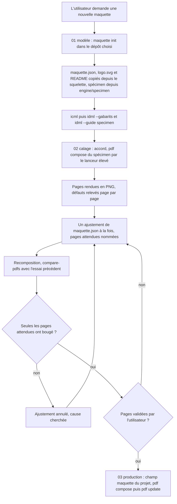
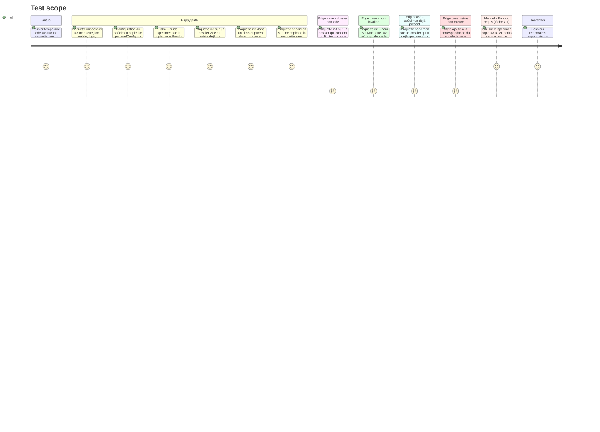

# Instruction: Skill `doc-pdf:maquette`, commandes `maquette init` et `maquette specimen` (0.5.0)

## Architecture projection

> Fichiers en fin de phase. ✅ créer · ✏️ modifier · ❌ supprimer

```txt
.claude-plugin/marketplace.json                      ✏️ doc-pdf 0.5.0 (règle M1)
plugins/doc-pdf/
├── .claude-plugin/plugin.json                       ✏️ 0.5.0
├── .codex-plugin/plugin.json                        ✏️ 0.5.0
├── CHANGELOG.md                                     ✏️ entrée 0.5.0
├── README.md                                        ✏️ deux skills, créer une maquette en trois temps
├── skills/
│   ├── doc-pdf/SKILL.md                             ✏️ l. 46 : une maquette se modifie par la skill `maquette` ; table et References
│   └── maquette/
│       ├── SKILL.md                                 ✅ routage, table `| # | Action | Rôle |`, règles transversales
│       ├── actions/
│       │   ├── 01-modele.md                         ✅ dossier de maquette, spécimen, modèle IDML et ICML
│       │   ├── 02-calage.md                         ✅ boucle composer → rendre → ajuster → comparer
│       │   └── 03-production.md                     ✅ bascule d'un projet, pdf compose puis pdf update
│       └── evals/
│           ├── scenarios.json                       ✅ routage modele / calage / production / hors skill
│           └── routing-autonomy-scenarios.md        ✅ frontière avec doc-pdf:doc-pdf, accords demandés
├── references/runbook-export-indesign.md            ✏️ renvoi vers la skill pour créer ou recaler une maquette
└── engine/
    ├── maquette.js                                  ✏️ initMaquette(dossier, { nom }), addSpecimen(dossier)
    ├── cli.js                                       ✏️ commandes `maquette init <dossier>` et `maquette specimen <dossier>`, usage()
    ├── maquettes/squelette/README.md                ✅ désigner la maquette, les trois temps, ce qui se modifie
    ├── specimen/                                    ✅ source copiée dans <maquette>/specimen/ (hors de maquettes/ : ce n'est pas une maquette)
    │   ├── documentation.config.json                ✅ configuration complète, chemins relatifs au spécimen copié
    │   ├── version.json                             ✅ { "version": "0.0.0" }, lu par readVersion
    │   ├── pages-gabarit.json                       ✅ sous-titre, pages de fin, `miseAJour` ; pied et mentions venus de la maquette
    │   └── guide-specimen/
    │       ├── 01-structure.md                      ✅ titres, paragraphes, listes, tableaux
    │       ├── 02-encadres.md                       ✅ chaque type d'encadré, code, citations
    │       ├── 03-images.md                         ✅ image large, image étroite
    │       └── images/                              ✅ deux captures neutres (reprises de tests/fixtures/icml/images)
    └── tests/
        ├── fixtures/specimen/specimen.pandoc.icml   ✅ sortie Pandoc figée du spécimen
        ├── maquette.unit.test.js                    ✏️ initMaquette et addSpecimen : dossier non vide, dossier vide existant, parent absent, nom invalide, rien d'écrit sur échec, ligne .gitignore sans doublon
        ├── specimen.unit.test.js                    ✅ chaque style de la correspondance du squelette apparaît dans le spécimen ; copie par initMaquette lue par loadConfig et passée à idml --guide specimen (sans Pandoc)
        └── cli.unit.test.js                         ✏️ aiguillage `maquette`, sous-commande inconnue, usage
```

## User Journey



## Test Scope



## Tasks to do

### `1)` Spécimen de calage

> Un texte court qui exerce chaque style de la maquette, pour caler une maquette sans dépendre des textes d'un projet.

1. Partir de `tests/fixtures/icml/echantillon.md` et l'étendre en trois fichiers numérotés : structure, encadrés, images.
2. Exercer chaque entrée de la correspondance Markdown → InDesign du squelette (titres de chaque niveau, listes simples et numérotées, tableau, chaque type d'encadré, code, citation, image large et étroite) et les pages communes (sommaire, pages de fin, mentions).
3. Texte en français, neutre, sans marque ni contenu client. Paragraphes de longueurs variées, pour faire apparaître veuves, orphelines et débordements dès le premier essai.
4. `documentation.config.json` du spécimen, complet pour qu'aucune valeur ne dépende du dépôt où il est copié :
   - `maquette: ".."`, `sourceDir: "."`, `pagesFile: "pages-gabarit.json"`, `outputDir: "output"`, `versionFile: "version.json"` ;
   - un guide `{ id: "specimen", dir: "guide-specimen", title, verb, accent }`, sans `mergedFile` : le spécimen n'a pas de version fusionnée ;
   - l'accent est réécrit à la copie avec l'axe par défaut de la maquette (tâche 2).
5. `version.json` vaut `{ "version": "0.0.0" }` : `readVersion` (`guide-config.js:185-189`) lit le champ `version` de tout JSON. Sans lui, `findUp` chercherait un `package.json` au-dessus du dépôt de maquette.
6. `pages-gabarit.json` ne porte ni `pied` ni `mentions` : le spécimen exerce ceux de la maquette (bloc `commun`, phase 4).
7. Figer la sortie Pandoc dans `tests/fixtures/specimen/specimen.pandoc.icml`, sur le modèle d'`echantillon.pandoc.icml`, avec la commande de régénération en tête du test.
8. `specimen.unit.test.js` :
   - transformer cette sortie avec le squelette, puis vérifier que chaque style de paragraphe et de caractère de la correspondance apparaît au moins une fois. Un style absent est nommé ;
   - copier le spécimen par `initMaquette` dans un dossier temporaire, lire sa configuration par `loadConfig`, puis lancer `idml --guide specimen` : aucun ICML ni Pandoc n'est nécessaire, et `guidePages` exerce le pied et les mentions de la maquette.
   - `icml` lance Pandoc, qu'aucun test du moteur n'appelle : il se constate à la main en tâche 7.1.

### `2)` `maquette init` et `maquette specimen`

> Créer le dossier d'une maquette en une commande, sans recopier le squelette à la main.

1. `initMaquette(dossier, { nom })` (`maquette.js`) :
   - refuse un dossier qui existe et n'est pas vide ;
   - `nom` vaut par défaut le nom du dossier ; il doit respecter `^[a-z0-9-]+$`, parce qu'il préfixe les modèles IDML (`<nom>-<axe>.idml`) ;
   - après ces deux contrôles seulement, crée le dossier parent s'il manque (`fs.mkdirSync(parent, { recursive: true })`, comme `init`, `cli.js` l. 86) : le dossier temporaire voisin ne peut naître que dans un parent existant, et un dépôt dédié neuf n'en a pas encore. Un refus ne laisse ainsi aucun dossier créé ;
   - écrit dans un dossier temporaire voisin `maquette.json` (champ `nom` remplacé), `logo.svg` et `README.md`, copiés de `engine/maquettes/squelette/`, puis le spécimen, copié d'`engine/specimen/` dans `specimen/` ; valide le résultat par `loadMaquette`, puis renomme le dossier temporaire ;
   - si la destination existe vide, la retirer par `fs.rmdirSync` juste avant le renommage : cet appel n'est pas récursif et refuse un dossier non vide. Sous Windows, un renommage vers un dossier existant échoue (EPERM) ;
   - en cas d'échec, supprime le dossier temporaire : rien n'est écrit à la destination.
2. `addSpecimen(dossier)` : exige une maquette que `loadMaquette` accepte et l'absence de `specimen/`. Copie le spécimen sans toucher aux autres fichiers, hors la ligne ajoutée au `.gitignore` (étape 3). Une maquette existante peut ainsi être recalée de la même façon (Scriptami comprise).
   - Les deux fonctions écrivent dans `specimen/documentation.config.json` l'axe par défaut de la maquette visée comme accent du guide `specimen`.
3. Les deux fonctions écrivent `specimen/output/` dans un `.gitignore` du dossier de maquette. Elles le créent s'il manque et ne dupliquent pas la ligne.
4. `cli.js` : aiguiller `maquette` comme `init` (l. 110), avant le contrôle de la table `SCRIPTS` (l. 111), avec les sous-commandes `init <dossier> [--nom <nom>]` et `specimen <dossier>`. Une sous-commande inconnue rend 1 et affiche l'usage. Ajouter les deux lignes à `usage()` (l. 61-75).
5. `squelette/README.md` : désigner la maquette par le champ `maquette` du projet, rappeler les trois temps de la skill et ce qui se modifie (seulement `maquette.json` et `logo.svg`, jamais le moteur).

### `3)` Skill `doc-pdf:maquette`

> La méthode rodée sur Scriptami, écrite une fois : l'agent la suit au lieu de la redécouvrir.

1. `SKILL.md` : frontmatter sur le modèle de `skills/doc-pdf/SKILL.md` (`name: maquette`, description qui nomme la création, le calage et la mise en production d'une maquette, `version` de la phase, `tags`). Ensuite :
   - la ligne host-portability ;
   - un `flowchart LR` `modele → calage → production` ;
   - la table `| # | Action | Rôle |` aux lignes `| 01 | \`modele\` | … |`, `02 calage`, `03 production`, que `consistency.mjs` contrôle (A1 à A3) ;
   - le routage, puis les règles transversales listées à l'étape 5.
2. `actions/01-modele.md` (H1 sans numéro, règle A4) :
   - choisir la destination avec l'utilisateur : un dépôt dédié pour une charte d'auteur, ou le dépôt `schema-*` de la gamme, à côté de `pack.json` ;
   - `maquette init <dossier>` ;
   - remplir `maquette.json` à partir de la charte fournie (page, grille, nuancier, axes, polices installées sous `C:\Windows\Fonts` ou dans le dossier de polices de l'utilisateur, `commun` : pied et mentions) ;
   - si les axes ont changé, reporter le nouvel axe par défaut dans l'accent de `specimen/documentation.config.json` ;
   - poser `logo.svg` ;
   - avec `--config <maquette>/specimen/documentation.config.json` : `icml`, `idml --gabarits --axe <axe>` pour chaque axe, puis `idml --guide specimen` ;
   - s'arrêter sur la liste des fichiers produits.
3. `actions/02-calage.md` :
   - demander l'accord, puis lancer `pdf compose --config <maquette>/specimen/documentation.config.json --guide specimen --sortie <scratchpad>/essai-<n>.indd` par le lanceur élevé de la phase 1, InDesign fermé ;
   - rendre les pages par `pdftoppm -png -r 60` dans le scratchpad et les lire ;
   - relever les défauts page par page (débordement, cadre vide, veuve, couleur, interligne, coupure de tableau) ;
   - proposer **un** ajustement de `maquette.json`, en nommant les pages qui doivent changer ;
   - recomposer, puis lancer `compare-pdfs essai-<n-1>.pdf essai-<n>.pdf` : si d'autres pages que celles annoncées ont bougé, annuler l'ajustement et chercher la cause ;
   - finir quand l'utilisateur valide les pages, pas sur le seul avis de l'agent.
4. `actions/03-production.md` :
   - dans le projet, `init --maquette <dossier>`, ou ajout du champ `maquette` à une configuration existante ;
   - `icml`, puis, après accord, `pdf compose` de chaque guide ;
   - ensuite, `pdf update` pour les mises à jour de texte ;
   - lire le constat d'empreintes avant de déclarer un guide à jour ;
   - un défaut de mise en page vu en production renvoie au calage, sur le spécimen, jamais à une retouche du `.indd`.
5. Règles transversales du `SKILL.md` :
   - modifier seulement `maquette.json` et `logo.svg`, jamais le moteur, `run-indesign.ps1` ni les scripts ExtendScript ;
   - garder les noms de styles, de gabarits, de cadres et de variables du squelette, qui sont le vocabulaire du moteur ;
   - lancer InDesign seulement après l'accord de l'utilisateur, une composition à la fois ;
   - rien ne s'écrit dans un projet client pendant le calage ;
   - aucun commit ni aucun dépôt distant sans demande.

### `4)` Evals de routage

> Distinguer « composer un guide » de « créer ou recaler une maquette ».

1. `evals/scenarios.json`, sur le modèle de `design/skills/adjust/evals/scenarios.json` :
   - au moins trois prompts par action (`modele`, `calage`, `production`) ;
   - au moins trois prompts `null` qui relèvent de `doc-pdf:doc-pdf` (« régénère les ICML », « mets à jour le PDF du guide vendeur », « fusionne les guides »).
2. `evals/routing-autonomy-scenarios.md`, sur le modèle d'`adjust` :
   - autorité ;
   - préconditions (Pandoc, InDesign, `pdftoppm`) ;
   - table des situations, en particulier : demande de lancer InDesign sans accord, ajustement qui touche d'autres pages que celles annoncées, demande de retoucher le `.indd` à la main, demande de modifier le moteur ;
   - comment jouer les scénarios, observables décisifs, journal des résultats.

### `5)` Renvois depuis doc-pdf

> Une seule skill décrit la création d'une maquette ; l'autre y renvoie.

1. `skills/doc-pdf/SKILL.md`, l. 46 : « Ne jamais modifier la charte, les maquettes… » devient : la maquette se crée et se modifie par la skill `maquette` ; ne jamais modifier le moteur ni renommer `cerascan_object_styles`.
2. Ajouter `maquette init` et `maquette specimen` à la table des commandes, et la skill `maquette` aux References.
3. `references/runbook-export-indesign.md` : la création et le recalage d'une maquette renvoient à la skill. La section « 2. Styles à créer » ne change pas (test `icml-transform`).
4. `README.md` : deux skills, avec une phrase de rôle pour chacune ; les trois temps de la création d'une maquette.

### `6)` Bump 0.5.0

> Version et notes cohérentes dans les trois manifestes.

1. Mettre les trois manifestes à 0.5.0, avec la même description, qui mentionne la création de maquettes.
2. Écrire l'entrée 0.5.0 du CHANGELOG : skill `maquette`, commandes `maquette init` et `maquette specimen`, spécimen de calage.
3. Lancer `node tools/eval/consistency.mjs` (A1 à A4 sur la nouvelle skill, M1) et la suite Jest du moteur.
4. Les commits attendent la demande de l'utilisateur. Le cache installé reste à l'ancienne version tant qu'il n'est pas réinstallé : la skill `maquette` n'est appelable qu'après réinstallation.

### `7)` Preuve sur une vraie composition

> La méthode écrite doit tenir sur InDesign, après accord de l'utilisateur.

1. `maquette init <scratchpad>/essai-maquette`, puis la skill :
   - l'action `modele` lance `icml` sur le spécimen copié, Pandoc installé : c'est le seul contrôle de cette commande sur le spécimen. Constater des ICML écrits sans erreur de configuration ;
   - ensuite `idml --gabarits` et `idml --guide specimen`, puis le calage jusqu'au premier essai : spécimen composé, pages rendues, défauts relevés.
2. Un ajustement de `maquette.json` qui ne refait pas la pagination (par exemple la couleur des titres de niveau 2), en nommant d'abord les pages qui portent ces titres. Recomposition, puis `compare-pdfs` : seules ces pages ont bougé.
3. Constater dans le Planificateur qu'aucune tâche `doc-pdf-*` ne reste, puis supprimer le dossier d'essai du scratchpad.

## Test acceptance criteria

| Task | Acceptance criteria |
| ---- | ------------------- |
| 1 | Dans Jest, sans Pandoc, le spécimen copié par `initMaquette` dans un dossier temporaire est lu par `loadConfig` et passe `idml --guide specimen` sur le squelette, pied et mentions compris ; un style de la correspondance absent du spécimen fait échouer `specimen.unit.test.js` avec son nom. |
| 2 | `maquette init` sur un dossier vide écrit une maquette que `loadMaquette` accepte et un spécimen dont `loadConfig` accepte la configuration ; un dossier non vide ou un nom invalide est refusé sans aucun fichier écrit ; `maquette init` accepte un dossier vide qui existe déjà et crée un dossier parent absent ; `maquette specimen` ne modifie aucun fichier existant, hors la ligne `specimen/output/` ajoutée une seule fois au `.gitignore`, refuse un `specimen/` déjà présent et donne au guide `specimen` l'axe par défaut de la maquette visée. |
| 3 | `consistency.mjs` vérifie la table de la skill (A1 à A4) ; chaque action nomme ses commandes exactes et ses points d'accord ; aucune action n'autorise une modification du moteur. |
| 4 | Chaque prompt de `scenarios.json` désigne la bonne action ou `null` ; le document d'autonomie couvre les quatre situations listées. |
| 5 | Une recherche de « Ne jamais modifier la charte, les maquettes » dans `plugins/doc-pdf/` ne trouve plus rien ; le test `icml-transform` du runbook reste vert. |
| 6 | Les trois manifestes sont en 0.5.0 avec la même description ; `consistency.mjs` et la suite Jest sont verts. |
| 7 | `icml` passe sur le spécimen copié ; un spécimen composé sur une maquette neuve, un ajustement qui ne déplace que les pages attendues, aucune tâche `doc-pdf-*` restante. |

## Compte rendu

- Skill `doc-pdf:maquette` (modèle, calage, production), évals de routage et d'autonomie ; commandes `maquette init` et `maquette specimen` ; spécimen copié par `init` (champ `document` ajouté à sa configuration) ; README du squelette ; version 0.5.0 (trois manifestes + CHANGELOG). Jest : 456 verts ; `consistency.mjs`, `coverage.mjs` et `harness.mjs` verts.
- Preuve réelle sur une maquette neuve : init → icml → idml (gabarits, guide) → `pdf compose` (12 pages, 41 liens). Alertes relevées : chapeau d'ouverture à 94 % (page 3), un intertitre reporté, sommaires sans numéros au premier essai (reprise par `--maj-pages`).
- Calage : le levier est `formats.<style>` de `maquette.json`, pas les `attributes` de `styles.paragraph` (sans effet ; 02-calage corrigé). `formats.Intertitre-2.size` 15 → 17 : `compare-pdfs` montre 5 pages différentes (celles qui portent des sous-sections), même pagination.
- Aucune tâche planifiée `doc-pdf-*` restante ; dossier d'essai supprimé (accord donné).
- Le cache installé du plugin reste en 0.3.x tant qu'il n'est pas réinstallé.
- SHA du commit de fin de phase : 5f4869c
