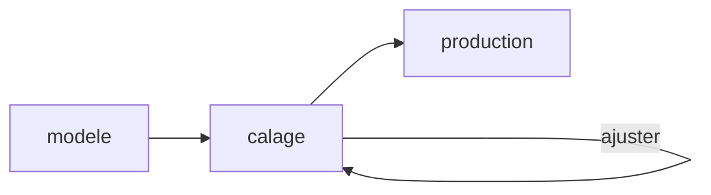

Read [host portability](../../references/host-portability.md) before resolving plugin files, invoking sibling skills, or persisting project guidance.

# maquette

Méthode rodée pour créer une maquette de mise en page, la caler sur un spécimen neutre, puis la brancher à un projet. Le moteur ne contient aucune valeur de marque : tout vit dans le dossier de la maquette.

Lire seulement l'action suivante du parcours choisi.

## Available actions

| # | Action | Rôle |
|---|--------|------|
| 01 | `modele` | Créer le squelette (`maquette init`), remplir `maquette.json`, poser le logo, ajouter le spécimen, générer ICML et IDML |
| 02 | `calage` | Composer le spécimen dans InDesign, lire les pages, ajuster un réglage à la fois, comparer avec l'essai précédent |
| 03 | `production` | Brancher un projet (`init --maquette`), composer et mettre à jour les guides |

## Default flow

- « crée une maquette », « nouvelle charte pour les écrits de jeu » → `modele`
- « le titre est mal placé », « recale la couleur », « compare avec l'essai précédent » → `calage`
- « utilise cette maquette dans le projet », « génère les PDF des guides » → `production`

Sans maquette existante, partir de `modele`. Avec une maquette déjà calée, aller à `production`.

## Transversal rules

- Résoudre `DOC_PDF_PLUGIN_ROOT` (cf. portabilité) ; le moteur s'appelle `node <DOC_PDF_PLUGIN_ROOT>/engine/cli.js`, jamais copié dans un projet.
- Ne modifier que `maquette.json`, `logo.svg` et `picto.json` de la maquette. Jamais le moteur, `run-indesign.ps1`, les scripts ExtendScript, les noms de styles, de gabarits, de cadres et de variables (vocabulaire du moteur), ni `cerascan_object_styles`.
- Piloter InDesign (`pdf compose`, `pdf update`, `compare-engines --pdf`) exige l'accord explicite de l'utilisateur, le document fermé et aucun terminal administrateur (tâche planifiée élevée). Sans accord, donner la commande au lieu de la lancer.
- Prérequis : Pandoc dans le PATH pour `icml` et `pdf` ; `pdftoppm` pour lire les pages. Sans eux, s'arrêter avant d'écrire.
- Un seul réglage de `maquette.json` à la fois, relu sur les pages rendues, jamais deviné.
- Ne pas activer cette skill pour un projet déjà configuré (régénérer les ICML, fusionner, mettre à jour un PDF) : renvoyer à `doc-pdf:doc-pdf`.
- Le dépôt qui porte une maquette n'a de distant qu'avec l'accord de l'utilisateur.
- Le dossier `specimen/output/` ne se versionne pas.

## References

- `../../references/runbook-export-indesign.md` : jeu de styles, gabarits, dépannage InDesign.
- `../../engine/maquettes/squelette/README.md` : usage d'une maquette.
