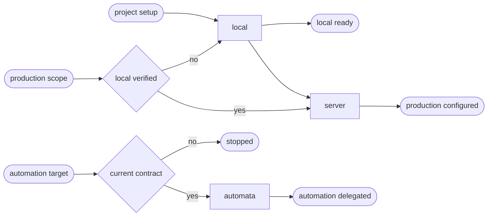

# PHP CD

## Actions

Run the flow above. Read only the next action file.

| Action | Does |
| --- | --- |
| local | reconcile the detected PHP framework locally |
| server | reconcile one named server target through the root facade |
| automata | validate and delegate one named automata target |

## Transversal rules

- Read [host portability](../../references/host-portability.md), [the common contract](../../references/cd-contract.md), and [the project schema](../../references/cd-project-contract.schema.json) before acting.
- Keep one root owner and treat JavaScript and CSS as bounded contributors in WordPress applications.
- Keep code, configuration, migrations, database, editorial content, and media as separate named surfaces.
- Never create another environment, reset WordPress, destroy containers, import a database during setup, or deploy merely because configuration was requested.
- Select an exact target id, phase and `deploy:*` operation; refuse ambiguous multi-target requests and every target-to-target or pull flow.
- For PrestaShop, read [the PrestaShop strategy](references/prestashop.md) and, before creating or reconciling Compose, `.gitignore` or a deployment script, [its templates](references/prestashop-templates.md). Never run the PrestaShop installer on an installed shop.
- Read [differential synchronization](../../references/cd-differential-sync.md) for staging data or media. Production mutable data, editorial content and uploads are target-authoritative.
